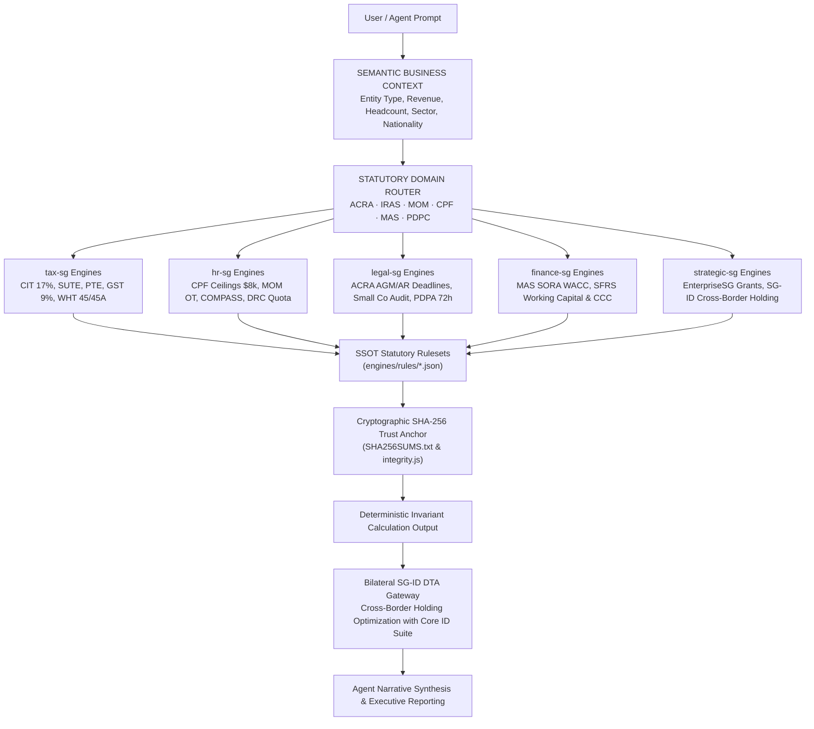
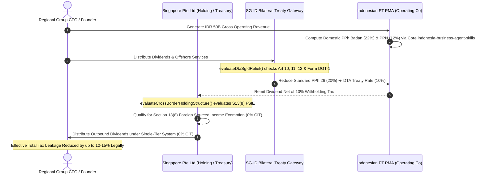

# Singapore Business Agent Skills

*Give AI agents an authentic business brain for Singapore corporate operations & cross-border governance.*

**Singapore corporate, tax, manpower & statutory intelligence for AI agents — combining IRAS rulesets, ACRA corporate compliance, MOM manpower frameworks, MAS financial benchmarks, and direct cross-border extension to Indonesia Business Agent Skills.**

<p align="center">
  
</p>

<p align="center">
  <a href="LICENSE"></a>
  <a href="https://github.com/adamriofc/singapore-business-agent-skills/actions/workflows/ci.yml"></a>
  <a href="https://app.openworklabs.com/"></a>
  <a href="engines/"></a>
  <a href="tests/"></a>
  <a href="bundles/full-business-suite.json"></a>
  <a href="https://github.com/adamriofc/indonesia-business-agent-skills"></a>
</p>

---

## 📌 Overview & Value Proposition

<!-- GENERATED:STATS -->
| Metric | Single Source of Truth Value | Measurement Scope |
|---|---|---|
| **Repository Version** | `v1.0.0` | SemVer release boundary |
| **Canonical Plugins** | `5` | Active domain plugins (`tax-sg`, `hr-sg`, `legal-sg`, `finance-sg`, `strategic-sg`) |
| **Agent Skills** | `15` | Machine-readable `SKILL.md` capability packs |
| **Deterministic Engines** | `15` | Pure Node.js calculation & statutory evaluation engines (`engines/`) |
| **Golden Cases** | `25` | Static corpus cases across 5 benchmark domains |
| **Benchmark Assertions** | `60` | Deterministic assertions in benchmark suites |
| **Total Test Assertions** | `120+` | Deepened matrix assertions across full `npm test` suite |
| **Node.js Compatibility** | `20 / 22 / 24` | `20` (Minimum Supported), `22` (LTS Recommended), `24` (Current Tested) |
<!-- /GENERATED:STATS -->

> **Evidence Boundary Note**: Engineered with mathematical determinism and audited against official Singapore statutory gazettes (IRAS, ACRA, MOM, CPF Board, MAS, PDPC). High-consequence corporate actions (such as statutory AGM filings or cross-border APA agreements) should remain subject to qualified professional human oversight.

---

### 🌐 Official Cross-Border Extension of Indonesia Business Agent Suite

**Singapore Business Agent Skills (`singapore-business-agent-skills`)** is the dedicated, production-grade Singapore regional and cross-border expansion of the core **[Indonesia Business Agent Skills (`indonesia-business-agent-skills`)](https://github.com/adamriofc/indonesia-business-agent-skills)** ecosystem.

Singapore serves as Southeast Asia's foremost regional corporate treasury, dispute resolution, and holding hub, while Indonesia represents the region's largest sovereign consumer and industrial market. Modern multinational enterprises, fast-growing tech ventures, and trading conglomerates consistently operate across both jurisdictions:
- **Parent / Regional Treasury**: Singapore Private Limited (`Pte Ltd`) enjoying a single-tier territorial tax system, intellectual property holding safe harbours, Section 13(8) Foreign Sourced Income Exemption (FSIE), and MAS SORA-linked liquidity.
- **Operating Operating Subsidiary**: Indonesian Foreign Investment Company (`PT PMA`) managing local industrial facilities, domestic supply chains, KBLI licensing, BPJS employment, and domestic PPh/PPN tax obligations.

By inheriting the strict engineering philosophy, zero-dependency doctrine, and cryptographic trust-anchor architecture of the core Indonesia suite, this repository enables AI agents to reason seamlessly across both jurisdictions without mathematical hallucination or regulatory mismatch.

```
┌────────────────────────────────────────────────────────────────────────┐
│             SOUTHEAST ASIA AGENT BUSINESS INTELLIGENCE SUITE           │
├───────────────────────────────────┬────────────────────────────────────┤
│ CORE ECOSYSTEM                    │ REGIONAL EXTENSION                 │
│ indonesia-business-agent-skills   │ singapore-business-agent-skills    │
│ 94 Skills · 6 Plugins · 61 Engines│ 15 Skills · 5 Plugins · 15 Engines │
│ Domestic ID Operations, PPh, BPJS │ Regional Holding, CIT, CPF, COMPASS│
└───────────────────────────────────┴────────────────────────────────────┘
                  │                                   │
                  └───────────────┬───────────────────┘
                                  ▼
         Bilateral SG-ID Double Taxation Agreement (DTA) Gateway
        Dividends (10%) · Interest (10%) · Royalties (10%) · FSIE
```

---

### 💡 Why Standard LLMs Fail at Singapore Business & Compliance Calculations

Generic large language models (such as unassisted GPT-4o or Claude 3.5 Sonnet) operate via probabilistic next-token prediction. When tasked with Singapore statutory compliance, standard LLMs encounter 3 critical failure modes:

1. **Arithmetic Hallucination**: AI models guess tax bracket sums and rebate calculations instead of computing exact statutory formulas. For example, unassisted LLMs frequently miss the tiered thresholds of the Start-Up Tax Exemption (SUTE) or miscalculate the 50% Corporate Income Tax (CIT) Rebate capped at S$40,000 for Year of Assessment (YA) 2024.
2. **Temporal Ambiguity**: Singapore regulations enforce progressive, multi-year statutory transitions that AI context windows conflate:
   - **CPF Ordinary Wage (OW) Ceiling**: Increased from S$6,000 (pre-Sept 2023) to S$6,800 (Jan 2024), S$7,400 (Jan 2025), and S$8,000 (Jan 2026).
   - **GST Rate Progression**: Shifted from 7% to 8% (2023) and 9% (from 1 Jan 2024).
   - **MOM COMPASS Framework**: Enforced from 1 Sept 2023 for new Employment Pass (EP) applications and 1 Sept 2024 for renewals.
3. **Unverifiable Statutory Lineage**: Standard LLMs cannot provide cryptographic audit trails confirming which specific act or gazette (e.g., *Companies Act 1967*, *Employment of Foreign Manpower Act*, *PDPA Part VIA*) governed a particular recommendation.

### 🛡️ The Hybrid Architecture Solution

This repository strictly decouples **natural language reasoning** from **mathematical computation**:
- **Agent Skill (`SKILL.md`)**: Analyzes unstructured context, extracts parameters, evaluates business intent, and synthesizes clear executive explanations.
- **Deterministic Engine (`engines/*.js`)**: Computes exact, immutable mathematics with **zero floating-point drift**, verified against static JSON statutory rulesets (`engines/rules/`) backed by **SHA-256 cryptographic trust anchors**.

---

## ⚙️ Compatibility & Testing Matrix

| Agent Runtime / Environment | Integration Level | Status | Verification Mechanism |
|---|---|---|---|
| **Node.js (v20, v22, v24)** | Native Engine Execution (`engines/`) | ✅ **Verified** | CI Matrix (`npm test` 120+ assertions & 25 golden cases) |
| **OpenCode CLI** | Native Skill Integration (`.opencode/skills/`) | ✅ **Verified** | Dynamic YAML Schema & Skill Protocol Tests |
| **OpenWork Desktop & Cloud** | Native Plugin Manifest (`.claude-plugin/`) | ✅ **Verified** | 5 Manifest Checks & SHA-256 Ruleset Integrity |
| **Claude Code (CLI)** | Native Plugin Installer (`npx skills`) | ✅ **Verified** | Universal Skill Protocol (`SKILL_PROTOCOL.md`) |
| **Cursor IDE** | Skill Shorthand (`.cursor/skills/`) | 🟡 **Compatible** | Agent Skill Standard Structure (`SKILL.md`) |
| **Codex** | Skill Shorthand (`.agents/skills/`) | 🟡 **Compatible** | Agent Skill Standard Structure (`SKILL.md`) |
| **OpenClaw** | Skill Shorthand via `.openclaw/skills/` | 🟡 **Compatible** | Copy skills to OpenClaw skill path |
| **Hermes** | Tool-use / Function Calling via pure JSON | 🟡 **Compatible** | Engine outputs are pure JSON; arguments map directly |
| **Custom SDK / CLI** | Programmatic Library & CLI binary | ✅ **Verified** | Root SDK (`index.js`), CLI (`sg-agent-skills`), Typings (`index.d.ts`) |

### 🧠 Minimum Model Capability Requirements

| Capability Tier | Minimum Model Specification | Target Domain & Workloads |
|---|---|---|
| **Class A: Complex Statutory & Legal Reasoning** | • High deductive reasoning capacity<br>• Context window $\ge$ 16k tokens<br>• Frontier cloud model or $\ge$ 70B local open-weights | Companies Act 1967 governance, PDPA 72-hour breach materiality assessments, MOM COMPASS strategic economic bonus scoring, and SG-ID cross-border holding tax treaty optimization. |
| **Class B: Structured Tool-Use & Parameter Extraction** | • Native Function Calling / Tool-Use support<br>• Strict JSON schema adherence<br>• Efficient cloud model or $\ge$ 7B–14B local model | Parameter extraction from business queries, CLI tool invocation (`sg-agent-skills cit`, `cpf`, `compass`), and automated statutory deadline alerting. |

---

## 🏗️ System Architecture



---

## 🌉 Cross-Border Singapore-Indonesia Bilateral Bridge

For regional groups operating across both jurisdictions, `singapore-business-agent-skills` bridges directly into `indonesia-business-agent-skills` to evaluate the **Double Taxation Agreement (DTA)** between Singapore and Indonesia:



---

## 📚 Documentation Architecture

```text
singapore-business-agent-skills/
  ├── README.md                 # Primary Overview, Value Proposition & Integration Guide
  ├── CHANGELOG.md              # Versioned release notes conforming to Keep a Changelog
  ├── SECURITY.md               # Prompt injection defense, payload isolation & reporting
  ├── PROVENANCE.md             # Official gazette citations & statutory rule origins
  ├── SKILL_PROTOCOL.md         # Open universal agent capability specification
  ├── canonical-metadata.json   # Single Source of Truth metrics & environment baseline
  ├── release-manifest.json     # Non-self-referencing release provenance & hash tracking
  ├── SHA256SUMS.txt            # Official cryptographic SHA-256 ruleset trust anchor
  └── docs/
      ├── BENCHMARK.md          # Measurement methodology & precision benchmark report
      ├── RELEASE.md            # Automated 18-Check Release Gate protocol
      ├── singapore-business-agent-skills-hero.svg # Master vector banner
      └── benchmark-results/    # Versioned machine-readable benchmark runs
          ├── baseline.json
          └── latest.json
```

---

## 🏢 Singapore Business Agent Suite — Installation Profiles

**One cohesive ecosystem. Five Singapore business domains. Choose your installation profile.**

```text
┌─────────────────────────────────────────────────────────────────┐
│             SINGAPORE BUSINESS AGENT SUITE v1.0.0               │
│         15 Skills · 5 Plugins · 15 Deterministic Engines        │
├──────────────────────────┬──────────────────────────────────────┤
│  FULL SUITE              │  SELECTIVE PROFILES                  │
│  All 5 domains           │  Compliance Pack (ACRA, IRAS, MOM)   │
│  15 skills               │  Finance & Strategy Pack             │
│  15 engines              │  Cross-Border ASEAN Expansion        │
└──────────────────────────┴──────────────────────────────────────┘
```

### Profile A — Full Business Suite (Recommended)
> All 5 domains · 15 skills · 15 engines

```bash
npx skills add adamriofc/singapore-business-agent-skills
```

**Use case**: Regional founders, venture builders, corporate secretarial firms, enterprise AI agents, and cross-border advisory practices.

### Profile B — Singapore Compliance Pack
> `legal-sg` + `tax-sg` + `hr-sg` · 11 skills · 11 engines

```bash
npx skills add adamriofc/singapore-business-agent-skills --domains legal-sg,tax-sg,hr-sg
```

**Use case**: Corporate secretaries, tax agents, HR managers, and corporate counsel managing ACRA AGM/AR filings, IRAS CIT/GST returns, MOM COMPASS scoring, and PDPA breach reporting.

### Profile C — Finance & Strategy Pack
> `finance-sg` + `strategic-sg` + `tax-sg` · 8 skills · 8 engines

```bash
npx skills add adamriofc/singapore-business-agent-skills --domains finance-sg,strategic-sg,tax-sg
```

**Use case**: CFOs, treasury teams, M&A analysts, and investment holding directors structuring MAS SORA-linked credit lines, SFRS working capital, and SG-ID cross-border holding tax models.

---

## 🛠️ Installation & Integration Guide

### 1. Universal Agent Skills CLI (Recommended)
Install skills directly across any supported agent framework (Claude Code, OpenCode, Codex, Cursor, OpenClaw, Hermes, Antigravity) using `npx`:

```bash
# Install all skills across the repository
npx skills add adamriofc/singapore-business-agent-skills

# Selective installation by agent framework or skill name
npx skills add adamriofc/singapore-business-agent-skills --agent claude-code
npx skills add adamriofc/singapore-business-agent-skills --skill cit-tax-sg

# Direct deterministic execution via Universal CLI (Zero external dependencies)
npx sg-agent-skills cit --income=180000 --startup=true
npx sg-agent-skills cpf --ow=6800 --age=32 --status=CITIZEN
npx sg-agent-skills compass --salary=8500 --age=29 --sector=NON_FINANCIAL_SERVICES
```

**💬 AI Agent Prompt Guide**:
> *"Please install the Singapore Business Agent Skills package into my workspace by running `npx skills add adamriofc/singapore-business-agent-skills`."*

---

### 2. Claude Code Marketplace (Official Plugin Integration)
Register the repository as a marketplace source and install individual domain plugins:

```bash
# Add the repository as a plugin marketplace source
claude plugin marketplace add adamriofc/singapore-business-agent-skills

# Install individual plugins from the marketplace
claude plugin install tax-sg@singapore-business-agent-skills
claude plugin install hr-sg@singapore-business-agent-skills
claude plugin install legal-sg@singapore-business-agent-skills
```

---

### 3. Portable Agent Skills Standard (.agents / .opencode / .cursor)
For native skill discovery without plugins, copy skills directly into your workspace:

```bash
# Canonical cross-agent skills directory
mkdir -p .agents/skills
cp -r tax-sg/skills/* .agents/skills/
cp -r hr-sg/skills/* .agents/skills/
cp -r legal-sg/skills/* .agents/skills/
cp -r finance-sg/skills/* .agents/skills/
cp -r strategic-sg/skills/* .agents/skills/

# OpenCode & Cursor native paths
mkdir -p .opencode/skills .cursor/skills
cp -r .agents/skills/* .opencode/skills/
cp -r .agents/skills/* .cursor/skills/
```

---

### 4. Custom SDK & Programmatic Import (Node.js & TypeScript)
Directly import engines into your Node.js/TypeScript backend, ERP systems, or serverless functions:

```javascript
// Programmatic SDK Import (Node.js / TypeScript)
const sbas = require('singapore-business-agent-skills');

// 1. Corporate Income Tax (CIT) for Qualifying Startup
const cit = sbas.calculateSingaporeCit({
  chargeableIncome: 180000,
  isQualifyingStartup: true,
  yearOfAssessment: 2024,
  hasLocalEmployeeWithCpf: true
});
console.log(`Gross Tax: S$${cit.taxBeforeRebateSgd}, Rebate: S$${cit.citRebateSgd}, Net Payable: S$${cit.netTaxPayableSgd}`);

// 2. CPF Contribution with 2024-2026 Progressive Ceiling Rules
const cpf = sbas.calculateSingaporeCpf({
  ordinaryWage: 6800,
  age: 32,
  residentialStatus: 'CITIZEN',
  calendarYear: 2024
});
console.log(`Employee CPF: S$${cpf.contributions.employeeCpfSgd}, Employer CPF: S$${cpf.contributions.employerCpfSgd}`);

// 3. MOM COMPASS Evaluation for Employment Pass (EP)
const compass = sbas.evaluateCompassEpEligibility({
  monthlySalarySgd: 9000,
  candidateAge: 30,
  sector: 'NON_FINANCIAL_SERVICES',
  salaryPercentileRank: 'P90_AND_ABOVE',
  qualificationLevel: 'TOP_TIER'
});
console.log(`Total Points: ${compass.totalCompassScore} (Pass: ${compass.isPassMarkMet})`);
```

---

## 📦 Plugin Inventory & Skill Catalog (15 Skills Across 5 Plugins)

All 15 capabilities are fully mapped in `registry/capabilities.json` with standardized domain namespaces and strict capability contracts:

### 1. `tax-sg`: Singapore Tax Intelligence (4 Skills)
* `cit-tax-sg`: Corporate Income Tax (CIT) 17% calculation incorporating Start-Up Tax Exemption (SUTE: 75% on first $10k, 50% on next $190k), Partial Tax Exemption (PTE), YA 2024 50% CIT Rebate (cap S$40k), and CIT Rebate Cash Grant (S$2k).
* `gst-sg`: Goods and Services Tax (GST) calculation supporting statutory 9% rate (effective 2024), retrospective & prospective compulsory registration liability audit (S$1M taxable turnover threshold), and quarterly input/output GST return ledger.
* `wht-sg`: Statutory Withholding Tax (WHT) under Income Tax Act Sections 45 (interest 15%), 45A (royalties 10%), and 45D (director fees 24% / technical service fees 17%).
* `dta-sg-id`: Singapore-Indonesia Double Tax Agreement (DTA) bilateral relief engine for dividends (Art 10: 10%), interest (Art 11: 10%), royalties (Art 12: 10%), and independent personal services (Art 14).

### 2. `hr-sg`: Singapore HR & Manpower Intelligence (4 Skills)
* `cpf-calculator`: Central Provident Fund (CPF) calculation with statutory progressive Ordinary Wage (OW) ceiling transition ($6,800 in 2024, $7,400 in 2025, $8,000 in 2026), age brackets, Additional Wage (AW) ceiling cap, Skills Development Levy (SDL), and ethnic self-help group funds (CDAC, MBMF, SINDA, ECF).
* `mom-overtime`: Employment Act 1968 Part IV coverage evaluation (workman $\le$ S$4,500, non-workman $\le$ S$2,600), 1.5x basic rate overtime pay calculation, statutory 72-hour monthly OT limit and 12-hour daily work limit compliance audit, and annual leave entitlement.
* `compass-scoring`: MOM Complementarity Assessment Framework (COMPASS) deterministic evaluation for Employment Pass (EP) eligibility across 4 foundational criteria (Salary, Qualifications, Diversity, Support for Local Employment) and 2 bonus criteria (Skills Bonus, Strategic Economic Priorities) against the 40-point pass mark.
* `foreign-workforce-quota`: Dependency Ratio Ceiling (DRC) and S-Pass sub-quota calculation across Services (DRC 35%, S-Pass 10%), Manufacturing (DRC 60%), Construction, Process, and Marine Shipyard sectors, with Foreign Worker Levy (FWL) tiering.

### 3. `legal-sg`: Corporate Secretarial & Regulatory Intelligence (3 Skills)
* `acra-statutory-deadlines`: Companies Act 1967 statutory AGM (within 6 months for private companies) and Annual Return (AR - within 7 months for private companies) filing deadline calculations, late filing tier penalties (S$300-S$600), and Sections 145/171 resident director and secretary governance audit.
* `small-company-audit`: Small Company Audit Exemption evaluation under the Thirteenth Schedule of the Companies Act 1967 (revenue $\le$ S$10M, assets $\le$ S$10M, employees $\le$ 50) including 2-of-3 consecutive financial years rule and consolidated group test.
* `pdpa-breach-notification`: Personal Data Protection Act 2012 (Part VIA) mandatory data breach notification evaluation (72-hour statutory deadline to PDPC), significant harm and significant scale ($\ge 500$ individuals) triggers, and turnover-based administrative financial penalty ceiling (up to 10% of annual turnover in Singapore).

### 4. `finance-sg`: Corporate Finance & Treasury Intelligence (2 Skills)
* `sora-wacc`: Corporate Weighted Average Cost of Capital (WACC) using the Singapore Overnight Rate Average (SORA) benchmark rate, CAPM cost of equity, and 17% CIT debt tax shield.
* `working-capital-sg`: Working capital efficiency, liquidity ratios (Current, Quick, Cash ratios), and Cash Conversion Cycle (DSO, DIO, DPO) under Singapore Financial Reporting Standards (SFRS).

### 5. `strategic-sg`: Strategic Planning & Cross-Border Governance (2 Skills)
* `enterprise-grant-sg`: Enterprise Singapore (EnterpriseSG) and IMDA grant co-funding evaluation for Enterprise Development Grant (EDG), Productivity Solutions Grant (PSG), and Market Readiness Assistance (MRA).
* `cross-border-holding-sg-id`: Cross-border holding structure optimization comparing Direct Investment vs Singapore Holding Company intermediary under the SG-ID DTA, Section 13(8) foreign-sourced dividend tax exemption, Single-Tier 0% outbound dividend tax, and Section 13W capital gains safe harbour.

---

## 👥 Who Uses This — Profession Based Use Cases

### 🏢 1. Singapore Corporate Secretary & Registered Filing Agent (RFA)
**Problem**: Managing filing calendars, audit exemptions, and board compliance for hundreds of client entities without missing statutory deadlines.

| Task | Skills Used |
|---|---|
| Track statutory AGM and Annual Return filing dates post-FYE | `acra-statutory-deadlines` |
| Audit Small Company Audit Exemption eligibility for private groups | `small-company-audit` |
| Assess mandatory 72-hour data breach notification to PDPC | `pdpa-breach-notification` |
| Audit resident director (Sec 145) and corporate secretary (Sec 171) qualifications | `acra-statutory-deadlines` |

> ⚡ **30-Second Killer Demo**:
> **Query**: *"A private client entity closed FYE on 31 December 2024. They had S$8.2M revenue, S$6.5M assets, and 24 employees. Calculate their exact AGM/AR deadlines, late penalty exposure if filed on 15 September 2025, and whether they qualify for audit exemption."*
>
> **Agent Execution**:
> 1. **[ACRA Engine]** → Private non-listed company: AGM statutory deadline = **30 June 2025**; AR deadline = **31 July 2025**.
> 2. **[ACRA Engine]** → Filing on 15 September 2025 is 46 days late → Statutory Late Filing Penalty = **S$300**.
> 3. **[Audit Engine]** → Revenue $\le$ S$10M (pass), Assets $\le$ S$10M (pass), Headcount $\le$ 50 (pass) → **3 of 3 criteria met** → **Audit Exemption Confirmed**.

---

### 🧾 2. Singapore Tax Advisor / IRAS Accredited Tax Practitioner
**Problem**: Clients require fast, exact answers on startup tax exemptions, YA 2024 rebates, GST registration liability, and withholding tax obligations.

| Task | Skills Used |
|---|---|
| Calculate net CIT with SUTE and YA 2024 50% rebate | `cit-tax-sg` |
| Audit S$1M turnover threshold for mandatory GST registration | `gst-sg` |
| Compute cross-border withholding tax under ITA Sections 45/45A | `wht-sg` |
| Optimize bilateral SG-ID tax treaty relief for cross-border royalties | `dta-sg-id` |

> ⚡ **30-Second Killer Demo**:
> **Query**: *"A qualifying tech startup incorporated in Singapore generated S$180,000 chargeable income in YA 2024 and employed 2 local staff. Calculate gross CIT, startup exemption, YA 2024 rebate, and final payable tax."*
>
> **Agent Execution**:
> 1. **[CIT Engine]** → SUTE Exemption: 75% of first S$10k (=S$7,500) + 50% of next S$170k (=S$85,000) = **S$92,500 total exemption**.
> 2. **[CIT Engine]** → Net Chargeable Income = S$180,000 − S$92,500 = S$87,500. Gross tax @ 17% = **S$14,875**.
> 3. **[CIT Engine]** → YA 2024 50% CIT Rebate: 50% of S$14,875 = S$7,437.50. Has local employee with CPF $\ge$ S$2,000 cash grant floor $\Rightarrow$ **Rebate = S$7,437.50**.
> 4. **[CIT Engine]** → Final Net Tax Payable = S$14,875 − S$7,437.50 = **S$7,437.50** (Effective Tax Rate = 4.13%).

---

### 👔 3. Regional HR Director & Talent Mobility Lead (MOM & CPF)
**Problem**: Managing foreign talent quotas, COMPASS scoring for Employment Passes, and payroll statutory ceilings across multi-year transitions.

| Task | Skills Used |
|---|---|
| Compute monthly CPF deductions matching progressive OW caps | `cpf-calculator` |
| Pre-screen EP candidates against MOM COMPASS 40-point threshold | `compass-scoring` |
| Audit company Dependency Ratio Ceiling (DRC) and S-Pass quotas | `foreign-workforce-quota` |
| Calculate 1.5x overtime pay and check Part IV 72-hour monthly limits | `mom-overtime` |

> ⚡ **30-Second Killer Demo**:
> **Query**: *"We are a Services sector company in Singapore with 20 full-time local employees and currently have 6 S-Pass holders. We want to sponsor a foreign Software Engineer (age 29, salary S$8,500/mo, degree from top-tier university). Can we hire, and what is our quota headroom?"*
>
> **Agent Execution**:
> 1. **[MOM COMPASS Engine]** → Monthly salary S$8,500 for age 29 is $\ge$ 90th percentile (C1 = 20 pts); Top-tier degree (C2 = 20 pts) $\Rightarrow$ Total Foundational Points = **40 pts** ($\ge$ 40 pts threshold met $\Rightarrow$ **EP Eligible**).
> 2. **[DRC Engine]** → Services Sector: Total workforce = 26. DRC 35% allows max 9.1 foreign workers; S-Pass sub-quota 10% allows max 2.6 S-Passes.
> 3. **[DRC Engine]** → Current S-Pass count (6) exceeds sub-quota cap (2.6) $\Rightarrow$ S-Pass hiring blocked, but **EP is not subject to DRC quotas**. The candidate can be hired directly on an EP.

---

### 📊 4. Corporate Treasury & Finance Director (MAS & SFRS)
**Problem**: Setting hurdle rates in a shifting interest rate environment and monitoring working capital liquidity under SFRS.

| Task | Skills Used |
|---|---|
| Calculate corporate WACC linked to 3-month Compounded SORA | `sora-wacc` |
| Evaluate debt tax shield under 17% Singapore CIT | `sora-wacc` |
| Compute Cash Conversion Cycle (DSO, DIO, DPO) & liquidity ratios | `working-capital-sg` |

> ⚡ **30-Second Killer Demo**:
> **Query**: *"Our Singapore corporate balance sheet has S$6M equity (Beta 1.15, ERP 5.5%) and S$4M debt funded at 3M SORA (3.65%) + 1.25% margin. Calculate our exact corporate WACC with tax shield."*
>
> **Agent Execution**:
> 1. **[WACC Engine]** → Risk-free rate (MAS 10Y SGS) = 2.80%. Cost of Equity $K_e = 2.80\% + 1.15 \times 5.5\% = \mathbf{9.125\%}$.
> 2. **[WACC Engine]** → Pre-tax Cost of Debt $K_d = 3.65\% + 1.25\% = 4.90\%$.
> 3. **[WACC Engine]** → After-tax Cost of Debt with 17% CIT tax shield $K_{d(net)} = 4.90\% \times (1 - 0.17) = \mathbf{4.067\%}$.
> 4. **[WACC Engine]** → Capital structure: 60% Equity, 40% Debt $\Rightarrow \text{WACC} = 0.60 \times 9.125\% + 0.40 \times 4.067\% = \mathbf{7.10\%}$.

---

### 🌐 5. ASEAN Regional Founder & Cross-Border Group Executive (SG + ID)
**Problem**: Structuring cross-border dividends, management fees, and IP royalties between a Singapore Holding entity and Indonesian operating subsidiary.

| Task | Skills Used |
|---|---|
| Compare Direct Investment vs Singapore Holding Company tax leakages | `cross-border-holding-sg-id` |
| Apply SG-ID DTA treaty rate reductions on dividends and royalties | `dta-sg-id` |
| Evaluate Enterprise Singapore MRA / EDG overseas expansion grants | `enterprise-grant-sg` |
| Qualify for Section 13(8) Foreign Sourced Income Exemption (FSIE) | `cross-border-holding-sg-id` |

> ⚡ **30-Second Killer Cross-Border Demo**:
> **Query**: *"Our group in Jakarta (PT PMA) is paying S$500,000 in dividends and S$200,000 in software royalties to our parent company in Singapore. Compare the total tax leakage under standard domestic rates vs our SG-ID DTA holding structure."*
>
> **Agent Execution**:
> 1. **[Cross-Border Engine]** → Without Treaty: Indonesian PPh 26 domestic withholding rate = 20% on dividends (S$100,000) and 20% on royalties (S$40,000) $\Rightarrow$ Total Leakage = **S$140,000**.
> 2. **[Cross-Border Engine]** → Under SG-ID DTA (with Certificate of Residence & DGT-1): Dividend withholding reduced to 10% (Art 10 = S$50,000); Royalty withholding reduced to 10% (Art 12 = S$20,000) $\Rightarrow$ Total Withholding = **S$70,000**.
> 3. **[CIT Engine]** → Singapore Receipt: Headline tax in Indonesia (22%) exceeds 15% subject-to-tax test $\Rightarrow$ **100% Tax Exempt under Section 13(8) FSIE**.
> 4. **[Synthesis]** → The Singapore holding structure secures an immediate **S$70,000 (50.0%) tax savings**, with zero subsequent corporate tax upon distribution to founders.

---

## 💻 Deterministic Engine Output Showcase

### 1. Corporate Income Tax (CIT) Engine — Actual Output
```javascript
const { calculateSingaporeCit } = require('singapore-business-agent-skills');

const result = calculateSingaporeCit({
  chargeableIncome: 180000,
  isQualifyingStartup: true,
  yearOfAssessment: 2024,
  hasLocalEmployeeWithCpf: true
});
console.log(JSON.stringify(result, null, 2));
```

```json
{
  "yearOfAssessment": 2024,
  "chargeableIncomeSgd": 180000,
  "statutoryTaxRate": 0.17,
  "taxSchemeApplied": "STARTUP_EXEMPTION_SUTE",
  "exemptions": {
    "tier1ExemptSgd": 7500,
    "tier2ExemptSgd": 85000,
    "totalExemptIncomeSgd": 92500
  },
  "taxableIncomeAfterExemptionSgd": 87500,
  "taxBeforeRebateSgd": 14875,
  "citRebatePercent": "50%",
  "citRebateCapSgd": 40000,
  "citRebateSgd": 7437.5,
  "netTaxPayableSgd": 7437.5,
  "effectiveTaxRate": 0.0413,
  "statutoryReference": "Singapore Income Tax Act 1947 Section 43 & Budget 2024 CIT Rebate"
}
```

---

### 2. CPF Progressive Ceiling Engine — Actual Output
```javascript
const { calculateSingaporeCpf } = require('singapore-business-agent-skills');

const result = calculateSingaporeCpf({
  ordinaryWage: 7000,
  age: 32,
  residentialStatus: 'CITIZEN',
  calendarYear: 2024
});
console.log(JSON.stringify(result, null, 2));
```

```json
{
  "calendarYear": 2024,
  "age": 32,
  "residentialStatus": "CITIZEN",
  "ordinaryWageSgd": 7000,
  "statutoryOwCeilingSgd": 6800,
  "cappedOwSgd": 6800,
  "contributions": {
    "employeeRate": 0.2,
    "employerRate": 0.17,
    "employeeCpfSgd": 1360,
    "employerCpfSgd": 1156,
    "totalCpfSgd": 2516
  },
  "skillsDevelopmentLevySgd": 17.5,
  "statutoryReference": "Central Provident Fund Act 1953 & CPF Board OW Ceiling Transition ($6,800 in 2024, $7,400 in 2025, $8,000 in 2026)"
}
```

---

## ❓ Frequently Asked Questions (FAQ)

### Q1: How does this repository connect to `indonesia-business-agent-skills`?
> **Answer**: `singapore-business-agent-skills` is the official Singapore corporate & cross-border extension of `indonesia-business-agent-skills`. It shares the same zero-dependency architectural doctrine, 18-check release gate rigor, closed prompt-injection defense boundaries, and SHA-256 trust-anchor specification. When used together, AI agents can execute cross-border holding evaluations, managing both the Singapore parent entity (Pte Ltd) and the Indonesian operating subsidiary (PT PMA) with continuous mathematical determinism.

### Q2: Why should AI agents not calculate Singapore tax or CPF using standard LLM token generation?
> **Answer**: Standard LLMs predict words probabilistically and frequently hallucinate numbers. In Singapore tax and payroll, an arithmetic error can lead to under-withholding penalties from IRAS (Section 94 of ITA) or CPFB late interest charges (1.5% per month). This repository isolates all calculations inside pure Node.js engines with static rulesets, eliminating LLM mathematical hallucination.

### Q3: How does the engine handle progressive CPF wage ceiling changes from 2024 to 2026?
> **Answer**: Under the CPF Board statutory roadmaps, the Ordinary Wage (OW) ceiling transitions systematically:
> - **2023 (pre-Sept)**: S$6,000 / month
> - **2024**: S$6,800 / month
> - **2025**: S$7,400 / month
> - **2026**: S$8,000 / month
> The `cpf-calculator` engine automatically applies the precise statutory ceiling based on the evaluation date or calendar year parameter.

### Q4: Does the GST engine support both retrospective and prospective liability tests?
> **Answer**: **Yes, 100%.** Under the *Goods and Services Tax Act 1993*, a business must register for GST under two separate tests:
> 1. **Retrospective Basis**: Taxable turnover at the end of any calendar year exceeds S$1,000,000.
> 2. **Prospective Basis**: At any time, there is reasonable expectation that taxable turnover in the next 12 months will exceed S$1,000,000.
> The `gst-sg` engine evaluates both tests deterministically and outputs exact statutory filing deadlines (within 30 days of liability).

### Q5: How is MOM COMPASS evaluated for Employment Pass (EP) candidates?
> **Answer**: The `compass-scoring` engine evaluates 4 foundational criteria: C1 Salary (0, 10, or 20 pts based on age and sector benchmarks), C2 Qualifications (0, 10, or 20 pts based on accredited institution tiers), C3 Diversity (firm nationality share), and C4 Local Employment Support (firm local PMET share), plus 2 bonus criteria (Skills Bonus C5 and Strategic Economic Priority C6). Candidates require $\ge 40$ points to qualify.

### Q6: Is my company’s financial and payroll data kept private and secure?
> **Answer**: **100% Private and Air-Gapped.** All computational engines (`engines/`) execute locally within your machine or VPC runtime. There are zero external API calls, zero telemetry pings, and zero external runtime dependencies (`dependencies: {}`).

### Q7: Can calculations from this repository be used as formal legal or tax counsel?
> **Answer**: Calculations provide decision-support intelligence grounded in official Singapore statutory gazettes. While the formulas match statutory legislation, formal corporate filings should be reviewed by an ACRA Registered Filing Agent (RFA), IRAS Accredited Tax Practitioner, or qualified Singapore legal advocate.

### Q8: How can I integrate these engines into existing ERP or HRMS software?
> **Answer**: All engines are modular, pure Node.js standard library functions with zero dependencies. You can import them directly via `const sbas = require('singapore-business-agent-skills')`, execute them from shell scripts via the `sg-agent-skills` CLI binary, or bundle them into serverless cloud microservices (AWS Lambda, Cloudflare Workers, Google Cloud Run).

---

## 🧪 Comprehensive Test & Verification Suite

The repository maintains an automated validation pipeline with over **120+ deep assertions** across multiple testing dimensions:

```bash
# 1. Run full unit test suite (Tax, HR, Legal, Finance, Strategy, TypeScript)
npm test

# 2. Run security suite (Prompt injection defense, adversarial fuzzing, supply-chain)
npm run test:security

# 3. Run cross-domain end-to-end integration test
npm run test:integration

# 4. Run CLI binary suite
npm run test:cli

# 5. Run Bubblewrap (bwrap) unprivileged Linux sandbox test
npm run test:sandbox

# 6. Run isolated package tarball smoke test
npm run test:smoke

# 7. Run automated release gate (18-Check Pipeline)
npm run validate:release
```

---

## 🛡️ Security, Provenance & Disclaimers

- **Security Policy**: See [`SECURITY.md`](SECURITY.md) for vulnerability disclosure and prompt injection isolation policies.
- **Statutory Provenance**: See [`PROVENANCE.md`](PROVENANCE.md) for official gazette references (Singapore Statutes Online, IRAS, ACRA, MOM, CPF Board, MAS, PDPC).
- **Skill Specification**: Conforms to the open [`SKILL_PROTOCOL.md`](SKILL_PROTOCOL.md) contract standard.
- **Cryptographic Trust Anchor**: All statutory rulesets in `engines/rules/` are cryptographically locked in [`SHA256SUMS.txt`](SHA256SUMS.txt) and verified via `npm run sha256:verify`.

---

## 📄 License & Commercial Terms

Distributed under the **GNU Affero General Public License v3.0** (AGPL-3.0). See [`LICENSE`](LICENSE) for full legal text.

> **Enterprise & Commercial Licensing**: For proprietary application embedding, SaaS platforms, or closed-source enterprise deployments seeking exemption from AGPL-3.0 copyleft requirements, custom commercial licenses are available.
> Contact: `adamriofc@protonmail.com` or `adamrofc@gmail.com`.
