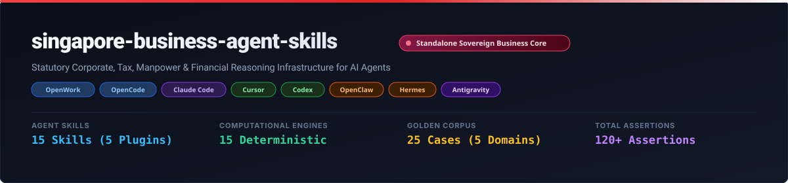
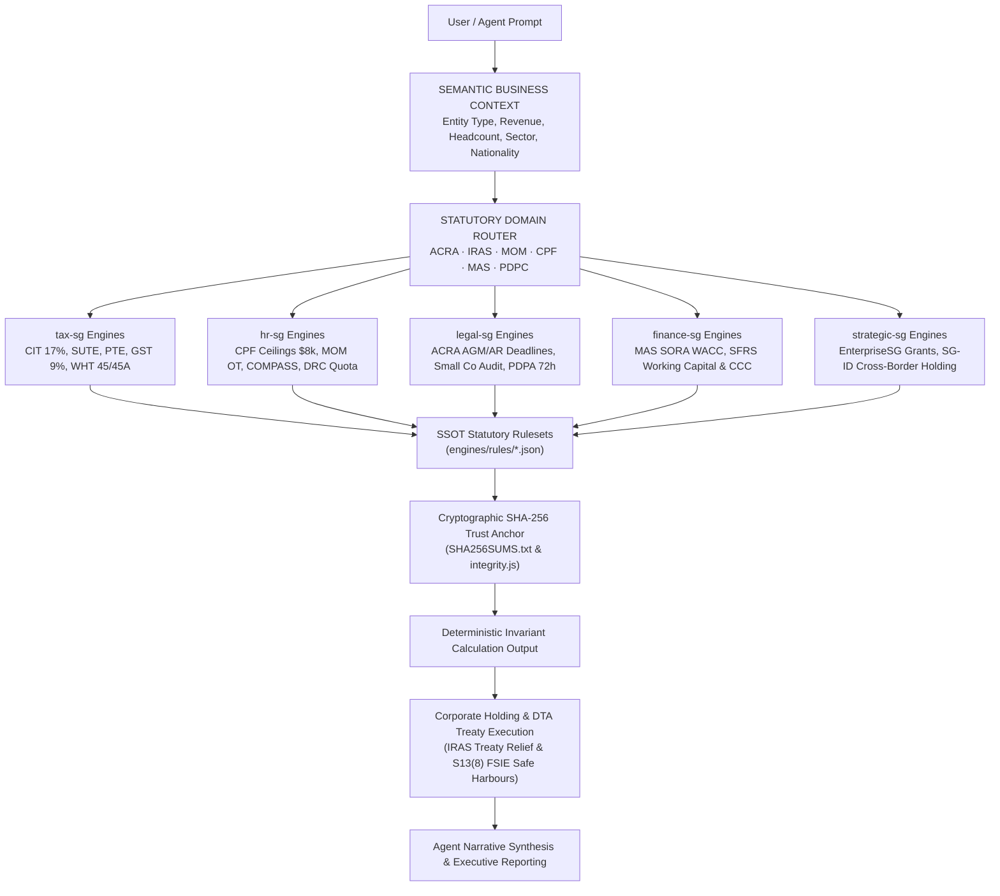

# Singapore Business Agent Skills

*Give AI agents a business brain for Singapore business.*

**Singapore business intelligence for AI agents — combining regulatory grounded skills, temporal rulesets, deterministic engines, and auditable provenance.**

<p align="center">
  
</p>

<p align="center">
  <a href="LICENSE"></a>
  <a href="https://github.com/adamriofc/singapore-business-agent-skills/actions/workflows/ci.yml"></a>
  <a href="https://app.openworklabs.com/"></a>
  <a href="engines/"></a>
  <a href="tests/"></a>
  <a href="bundles/full-business-suite.json"></a>
  <a href="engines/rules/"></a>
</p>

---

## 📌 Overview & Value Proposition

<!-- GENERATED:STATS -->
| Metric | Single Source of Truth Value | Measurement Scope |
|---|---|---|
| **Repository Version** | `v1.0.0` | SemVer release boundary |
| **Canonical Plugins** | `5` | Active domain plugins (`tax-sg`, `hr-sg`, `legal-sg`, `finance-sg`, `strategic-sg`) |
| **Agent Skills** | `15` | Machine-readable `SKILL.md` capability packs |
| **Deterministic Engines** | `15` | Pure Node.js calculation & statutory evaluation engines (`engines/`) |
| **Golden Cases** | `25` | Static corpus cases across 5 benchmark domains |
| **Benchmark Assertions** | `60` | Deterministic assertions in benchmark suites |
| **Total Test Assertions** | `120+` | Deepened matrix assertions across full `npm test` suite |
| **Node.js Compatibility** | `20 / 22 / 24` | `20` (Minimum Supported), `22` (LTS Recommended), `24` (Current Tested) |
<!-- /GENERATED:STATS -->

> **Evidence Boundary Note**: Independent external domain validation and enterprise production proof are still pending.

**Singapore Business Agent Skills** is a domain intelligence infrastructure designed to give AI agents an authentic Singapore business and regulatory intelligence layer. Built for **OpenWork Desktop**, **OpenCode CLI**, **Claude Code (CLI)**, **Cursor IDE**, **Codex**, **OpenClaw**, **Hermes**, **Gemini**, and custom agent frameworks, this repository integrates **15 Agent Skills** across **5 canonical plugins** (`tax-sg`, `hr-sg`, `legal-sg`, `finance-sg`, `strategic-sg`) with **15 Deterministic Computational & Statutory Engines** (`engines/`) and single source of truth temporal JSON rulesets (`engines/rules/`).

### 💡 Why Standard LLMs Fail at Singapore Business & Compliance Calculations
Generic AI models (such as unassisted ChatGPT or Claude) predict words probabilistically (*token prediction*). When tasked with calculating Corporate Income Tax (CIT) with Start-Up Tax Exemption (SUTE), CPF progressive wage ceilings, MOM COMPASS scoring, or ACRA statutory filing deadlines, standard LLMs encounter 3 critical failure modes:
1. **Arithmetic Hallucination**: AI models guess numbers rather than computing equations, leading to incorrect tax bracket assignments, missed YA 2024 rebate caps, and faulty CPF contribution math.
2. **Temporal Ambiguity**: AI models fail to track statutory wage caps and rate adjustments across transition windows (such as CPF Ordinary Wage ceiling progression from S$6,800 in 2024 to S$7,400 in 2025 and S$8,000 in 2026, or the GST rate transition to 9%).
3. **Unverifiable Lineage**: Standard AI responses lack traceable references to official statutory acts (*Singapore Statutes Online*), such as the *Companies Act 1967*, *Income Tax Act 1947*, *Employment Act 1968*, and *Personal Data Protection Act 2012*, rendering them unsuited for corporate audits.

### 🛡️ The Hybrid Architecture Solution
This repository decouples AI **reasoning** from **calculation**:
- **AI (Agent Skill)**: Understands natural language, extracts parameters, and synthesizes explanations.
- **Engine (Node.js)**: Computes exact invariant mathematics (deterministic computation removes LLM arithmetic hallucination within the engine) per official government rulesets.

---

## ⚙️ Compatibility & Testing Matrix

| Agent Runtime / Environment | Integration Level | Status | Verification Mechanism |
|---|---|---|---|
| **Node.js (v20, v22, v24)** | Native Engine Execution (`engines/`) | ✅ **Verified** | CI Matrix (`npm test` 120+ assertions & 25 golden cases) |
| **OpenCode CLI** | Native Skill Integration (`.opencode/skills/`) | ✅ **Verified** | Dynamic YAML Schema & Skill Protocol Tests |
| **OpenWork Desktop & Cloud** | Native Plugin Manifest (`.claude-plugin/`) | ✅ **Verified** | 5 Manifest Checks & SHA-256 Ruleset Integrity |
| **Claude Code (CLI)** | Native Plugin Installer (`npx skills`) | ✅ **Verified** | Universal Skill Protocol (`SKILL_PROTOCOL.md`) |
| **Cursor IDE** | Skill Shorthand (`.cursor/skills/`) | 🟡 **Compatible** | Agent Skill Standard Structure (`SKILL.md`) |
| **Codex** | Skill Shorthand (`.agents/skills/`) | 🟡 **Compatible** | Agent Skill Standard Structure (`SKILL.md`) |
| **OpenClaw** | Skill Shorthand via `.openclaw/skills/` | 🟡 **Compatible** | Copy skills to OpenClaw skill path |
| **Hermes** | Tool-use / Function Calling via pure JSON | 🟡 **Compatible** | Engine outputs are pure JSON; arguments map directly |
| **Custom SDK / CLI** | Programmatic Library & CLI binary | ✅ **Verified** | Root SDK (`index.js`), CLI (`sg-agent-skills`), Typings (`index.d.ts`) |

> **Integration Note — OpenClaw & Hermes**: These runtimes consume skills via their own tool-directory or MCP mechanism. Copy the relevant `*/skills/*/SKILL.md` files to your runtime's skill path, and import engine functions from `engines/*.js` directly. All engines are pure Node.js with no external dependencies.

### 🧠 Minimum Model Capability Requirements

To ensure optimal execution fidelity without vendor lock in, host agents should satisfy these minimum capability baselines across different task domains:

| Capability Tier | Minimum Model Specification | Target Domain & Workloads |
|---|---|---|
| **Class A: Complex Statutory & Legal Reasoning** | • High deductive reasoning capacity<br>• Context window $\ge$ 16k tokens<br>• Frontier cloud model or $\ge$ 70B local open-weights | Companies Act 1967 governance, PDPA 72-hour breach materiality assessments, MOM COMPASS strategic economic bonus scoring, and SG-ID cross-border holding tax treaty optimization. |
| **Class B: Structured Tool-Use & Parameter Extraction** | • Native Function Calling / Tool-Use support<br>• Strict JSON schema adherence<br>• Efficient cloud model or $\ge$ 7B–14B local model | Parameter extraction from business queries, CLI tool invocation (`sg-agent-skills cit`, `cpf`, `compass`), and automated statutory deadline alerting. |

---

## 🏗️ System Architecture



---

## 📚 Documentation Architecture

```text
singapore-business-agent-skills/
  ├── README.md                 # Primary Overview, Value Proposition & Integration Guide
  ├── CHANGELOG.md              # Versioned release notes conforming to Keep a Changelog
  ├── SECURITY.md               # Prompt injection defense, payload isolation & reporting
  ├── PROVENANCE.md             # Official gazette citations & statutory rule origins
  ├── SKILL_PROTOCOL.md         # Open universal agent capability specification
  ├── canonical-metadata.json   # Single Source of Truth metrics & environment baseline
  ├── release-manifest.json     # Non-self-referencing release provenance & hash tracking
  ├── SHA256SUMS.txt            # Official cryptographic SHA-256 ruleset trust anchor
  └── docs/
      ├── BENCHMARK.md          # Measurement methodology & precision benchmark report
      ├── RELEASE.md            # Automated 18-Check Release Gate protocol
      ├── singapore-business-agent-skills-hero.svg # Master vector banner
      └── benchmark-results/    # Versioned machine-readable benchmark runs
          ├── baseline.json
          └── latest.json
```

---

## 🏢 Singapore Business Agent Suite — Installation Profiles

**One cohesive ecosystem. Five Singapore business domains. Choose your installation profile.**

```text
┌─────────────────────────────────────────────────────────────────┐
│             SINGAPORE BUSINESS AGENT SUITE v1.0.0               │
│         15 Skills · 5 Plugins · 15 Deterministic Engines        │
├──────────────────────────┬──────────────────────────────────────┤
│  FULL SUITE              │  SELECTIVE PROFILES                  │
│  All 5 domains           │  Compliance Pack (ACRA, IRAS, MOM)   │
│  15 skills               │  Finance & Strategy Pack             │
│  15 engines              │  Cross-Border ASEAN Expansion        │
└──────────────────────────┴──────────────────────────────────────┘
```

### Profile A — Full Business Suite (Recommended)
> All 5 domains · 15 skills · 15 engines

```bash
npx skills add adamriofc/singapore-business-agent-skills
```

**Use case**: Regional founders, venture builders, corporate secretarial firms, enterprise AI agents, and cross-border advisory practices.

### Profile B — Singapore Compliance & Corporate Governance Pack
> `legal-sg` + `tax-sg` + `hr-sg` · 11 skills · 11 engines

```bash
npx skills add adamriofc/singapore-business-agent-skills --domains legal-sg,tax-sg,hr-sg
```

**Use case**: Corporate secretaries, tax agents, HR managers, and corporate counsel managing ACRA AGM/AR filings, IRAS CIT/GST returns, MOM COMPASS scoring, and PDPA breach reporting.

### Profile C — Finance, Treasury & Strategy Pack
> `finance-sg` + `strategic-sg` + `tax-sg` · 8 skills · 8 engines

```bash
npx skills add adamriofc/singapore-business-agent-skills --domains finance-sg,strategic-sg,tax-sg
```

**Use case**: CFOs, corporate treasurers, M&A analysts, and investment holding directors structuring MAS SORA-linked credit facilities, SFRS working capital, and SG-ID cross-border holding tax models.

### Profile D — Manpower & Talent Mobility Pack
> `hr-sg` · 4 skills · 4 engines

```bash
npx skills add adamriofc/singapore-business-agent-skills --domains hr-sg
```

**Use case**: HR managers, recruitment firms, talent mobility specialists, and corporate immigration teams managing CPF contributions, MOM overtime limits, COMPASS EP evaluations, and DRC quota headroom.

### Profile E — Cross-Border ASEAN Holding & Expansion Pack
> `strategic-sg` + `tax-sg` + `finance-sg` · 8 skills · 8 engines

```bash
npx skills add adamriofc/singapore-business-agent-skills --domains strategic-sg,tax-sg,finance-sg
```

**Use case**: Cross-border holding structures, foreign subsidiary dividend repatriation, bilateral DTA withholding tax relief, EnterpriseSG international expansion grants (MRA/EDG), and Section 13W capital gains safe harbour.

> **Architecture Note**: The Agent (LLM) owns orchestration. The Suite exposes capabilities — it does not route, plan, or execute reasoning on behalf of the agent. Each domain plugin remains independently installable and versioned in lockstep.
>
> Bundle manifests are located in [`bundles/`](bundles/) and validated by the 18-check release gate.

---

## 🛠️ Installation & Integration Guide

### 1. Universal Agent Skills CLI (Recommended / Universal)
Install skills directly across any supported agent framework (Claude Code, OpenCode, Codex, Cursor, OpenClaw, Hermes, Antigravity) using `npx`:

```bash
# Install all skills across the repository
npx skills add adamriofc/singapore-business-agent-skills

# Selective installation by agent framework or skill name
npx skills add adamriofc/singapore-business-agent-skills --agent claude-code
npx skills add adamriofc/singapore-business-agent-skills --skill cit-tax-sg

# Direct deterministic execution via Universal CLI (Zero external dependencies)
npx sg-agent-skills cit --income=180000 --startup=true
npx sg-agent-skills cpf --ow=6800 --age=32 --status=CITIZEN
npx sg-agent-skills compass --salary=8500 --age=29 --sector=NON_FINANCIAL_SERVICES
```

**💬 AI Agent Prompt Guide**:
> *"Please install the Singapore Business Agent Skills package into my workspace by running `npx skills add adamriofc/singapore-business-agent-skills`."*

---

### 2. Claude Code Marketplace (Official Plugin Integration)
Register the repository as a marketplace source and install individual domain plugins:

```bash
# Add the repository as a plugin marketplace source
claude plugin marketplace add adamriofc/singapore-business-agent-skills

# Install individual plugins from the marketplace
claude plugin install tax-sg@singapore-business-agent-skills
claude plugin install hr-sg@singapore-business-agent-skills
claude plugin install legal-sg@singapore-business-agent-skills
claude plugin install finance-sg@singapore-business-agent-skills
claude plugin install strategic-sg@singapore-business-agent-skills
```

**💬 AI Agent Prompt Guide**:
> *"Please register the marketplace source `adamriofc/singapore-business-agent-skills` and install the domain plugins (`tax-sg`, `hr-sg`, `legal-sg`, `finance-sg`, `strategic-sg`) using `claude plugin install <plugin>@singapore-business-agent-skills`."*

---

### 3. Portable Agent Skills Standard (.agents / .opencode / .cursor)
For native skill discovery without plugins, copy skills directly into your workspace:

```bash
# Canonical cross-agent skills directory
mkdir -p .agents/skills
cp -r tax-sg/skills/* .agents/skills/
cp -r hr-sg/skills/* .agents/skills/
cp -r legal-sg/skills/* .agents/skills/
cp -r finance-sg/skills/* .agents/skills/
cp -r strategic-sg/skills/* .agents/skills/

# OpenCode & Cursor native paths
mkdir -p .opencode/skills .cursor/skills
cp -r .agents/skills/* .opencode/skills/
cp -r .agents/skills/* .cursor/skills/
```

**💬 AI Agent Prompt Guide**:
> *"Please clone `https://github.com/adamriofc/singapore-business-agent-skills` and copy all skills from its domain directories (`tax-sg/skills`, `hr-sg/skills`, `legal-sg/skills`, `finance-sg/skills`, `strategic-sg/skills`) into my project's `.agents/skills/` (or `.opencode/skills/` / `.cursor/skills/`)."*

---

### 4. OpenWork Desktop & Cloud
1. Open **Settings > Plugins**.
2. Click **Add Plugin from Repository**.
3. Input the GitHub URL: `https://github.com/adamriofc/singapore-business-agent-skills`.
4. The 5 plugins and 15 skills activate automatically.

*Native MCP Server Integration (OpenWork Library / Claude Desktop)*:
```json
{
  "mcpServers": {
    "singapore-business": {
      "command": "npx",
      "args": ["-y", "sg-agent-skills", "serve", "--mcp"]
    }
  }
}
```

**💬 AI Agent Prompt Guide**:
> *"Please configure the Singapore Business MCP Server in my MCP client settings (such as OpenWork Settings > Library or claude_desktop_config.json) with command `npx` and args `[\"-y\", \"sg-agent-skills\", \"serve\", \"--mcp\"]`."*

---

### 5. Custom SDK & REST API Microservice
Directly import engines into your Node.js/TypeScript backend or run the standalone zero-dependency REST microservice to serve calculations across any tech stack (Python, Go, Java, PHP Laravel, C#, or ERP webhooks):

```javascript
// Programmatic SDK Import (Node.js / TypeScript)
const sbas = require('singapore-business-agent-skills');

// 1. Corporate Income Tax (CIT) for Qualifying Startup
const cit = sbas.calculateSingaporeCit({
  chargeableIncome: 180000,
  isQualifyingStartup: true,
  yearOfAssessment: 2024,
  hasLocalEmployeeWithCpf: true
});
console.log(`Gross Tax: S$${cit.taxBeforeRebateSgd}, Rebate: S$${cit.citRebateSgd}, Net Payable: S$${cit.netTaxPayableSgd}`);

// 2. CPF Contribution with 2024-2026 Progressive Ceiling Rules
const cpf = sbas.calculateSingaporeCpf({
  ordinaryWage: 6800,
  age: 32,
  residentialStatus: 'CITIZEN',
  calendarYear: 2024
});
console.log(`Employee CPF: S$${cpf.contributions.employeeCpfSgd}, Employer CPF: S$${cpf.contributions.employerCpfSgd}`);

// 3. MOM COMPASS Evaluation for Employment Pass (EP)
const compass = sbas.evaluateCompassEpEligibility({
  monthlySalarySgd: 9000,
  candidateAge: 30,
  sector: 'NON_FINANCIAL_SERVICES',
  salaryPercentileRank: 'P90_AND_ABOVE',
  qualificationLevel: 'TOP_TIER'
});
console.log(`Total Points: ${compass.totalCompassScore} (Pass: ${compass.isPassMarkMet})`);
```

```bash
# Start standalone REST API server (Default: http://localhost:3000)
npx sg-agent-skills serve --port 3000

# Invoke via curl from any language (Python, Go, PHP, Rust, etc.)
curl -X POST http://localhost:3000/api/v1/calc/cit \
  -H "Content-Type: application/json" \
  -d '{"chargeableIncome": 180000, "isQualifyingStartup": true, "yearOfAssessment": 2024}'
```

```python
# Python Integration Example
import requests

res = requests.post("http://localhost:3000/api/v1/calc/cit", json={
    "chargeableIncome": 180000,
    "isQualifyingStartup": True,
    "yearOfAssessment": 2024,
    "hasLocalEmployeeWithCpf": True
})
print("Net Tax Payable:", res.json()["result"]["netTaxPayableSgd"])
```

| Core REST Endpoints (`POST /api/v1/...`) | Functionality & Target Statute |
|---|---|
| `/calc/cit` | Corporate Income Tax 17%, SUTE, PTE, YA 2024 rebate & cash grant (*Income Tax Act Sec 43*) |
| `/calc/gst` | GST 9%, retrospective/prospective registration threshold audit (*GST Act 1993 Sec 8 & 9*) |
| `/calc/wht` | Statutory non-resident withholding tax (*Income Tax Act Sections 45, 45A, 45D*) |
| `/calc/dta-relief` | Bilateral DTA relief evaluation for dividends, interest, royalties, and services |
| `/calc/cpf` | CPF calculation with progressive OW ceiling transitions ($6.8k–$8.0k), SDL & Self-Help funds |
| `/calc/mom-ot` | Employment Act Part IV 1.5x overtime pay, monthly 72h limit, and daily 12h cap audit |
| `/calc/compass` | MOM COMPASS 40-point Employment Pass eligibility evaluation (C1–C4 + C5/C6 bonuses) |
| `/calc/drc-quota` | Dependency Ratio Ceiling (DRC), S-Pass sub-quota, and Foreign Worker Levy tiering |
| `/calc/acra-deadlines` | Companies Act Secs 175 & 197 AGM (6m/4m) and AR (7m/5m) statutory filing deadlines & late fees |
| `/calc/audit-exemption` | Small Company Audit Exemption evaluation (*Companies Act Thirteenth Schedule 2-of-3 rule*) |
| `/calc/pdpa-breach` | PDPA Part VIA mandatory 72-hour breach notification criteria and financial penalty ceilings |
| `/calc/sora-wacc` | Corporate WACC using MAS Compounded SORA, CAPM cost of equity, and 17% CIT tax shield |
| `/calc/working-capital` | Liquidity ratios (Current, Quick, Cash) & Cash Conversion Cycle (DSO/DIO/DPO) under SFRS |
| `/calc/enterprise-grant` | Enterprise Singapore EDG, PSG, and MRA co-funding grant eligibility and payout calculation |
| `/calc/cross-border-holding` | Holding structure comparison, Section 13(8) FSIE exemption, and Section 13W safe harbour |

**💬 AI Agent Prompt Guide**:
> *"Please start the Singapore Business REST API microservice by running `npx sg-agent-skills serve --port 3000` or import calculation engines directly via `require('singapore-business-agent-skills')`."*

---

## 📦 Plugin Inventory & Skill Catalog (15 Skills Across 5 Plugins)

All 15 capabilities are fully mapped in `registry/index.json` with defined *Quality Tiers* (`source-verified`, `tested`, `expert-reviewed`):

### 1. `tax-sg`: Singapore Tax Intelligence, Engineering & Compliance (4 Skills)
* `cit-tax-sg`: Corporate Income Tax (CIT) 17% calculation incorporating Start-Up Tax Exemption (SUTE: 75% on first $10k, 50% on next $190k), Partial Tax Exemption (PTE: 75% on first $10k, 50% on next $190k), YA 2024 50% CIT Rebate (cap S$40k), and CIT Rebate Cash Grant (S$2,000 for entities with $\ge 1$ local employee with CPF).
* `gst-sg`: Goods and Services Tax (GST) calculation supporting statutory 9% rate (effective 1 Jan 2024), retrospective & prospective compulsory registration liability audit (S$1,000,000 taxable turnover ceiling), and quarterly input/output GST return ledger.
* `wht-sg`: Statutory Withholding Tax (WHT) under Income Tax Act Sections 45 (interest 15%), 45A (royalties 10%), and 45D (director fees 24% / technical service fees 17%).
* `dta-sg-id`: Singapore-Indonesia Double Tax Agreement (DTA) bilateral relief engine for dividends (Art 10: 10%), interest (Art 11: 10%), royalties (Art 12: 10%), and independent personal services (Art 14).

### 2. `hr-sg`: Singapore Labor, Manpower & Employment Compliance (4 Skills)
* `cpf-calculator`: Central Provident Fund (CPF) calculation with statutory progressive Ordinary Wage (OW) ceiling transition ($6,800 in 2024, $7,400 in 2025, $8,000 in 2026), age brackets, Additional Wage (AW) ceiling cap ($102,000 − Total OW capped), Skills Development Levy (SDL: 0.25%, min $2, max $11.25), and ethnic self-help group funds (CDAC, MBMF, SINDA, ECF).
* `mom-overtime`: Employment Act 1968 Part IV coverage evaluation (workman $\le$ S$4,500, non-workman $\le$ S$2,600), 1.5x basic hourly rate overtime pay calculation, statutory 72-hour monthly OT limit and 12-hour daily work limit compliance audit, and annual leave entitlement.
* `compass-scoring`: MOM Complementarity Assessment Framework (COMPASS) deterministic evaluation for Employment Pass (EP) eligibility across 4 foundational criteria (Salary C1, Qualifications C2, Diversity C3, Support for Local Employment C4) and 2 bonus criteria (Skills Bonus C5, Strategic Economic Priorities C6) against the 40-point pass mark.
* `foreign-workforce-quota`: Dependency Ratio Ceiling (DRC) and S-Pass sub-quota calculation across Services (DRC 35%, S-Pass 10%), Manufacturing (DRC 60%), Construction, Process, and Marine Shipyard sectors, with tiered Foreign Worker Levy (FWL) schedules.

### 3. `legal-sg`: Corporate Secretarial, ACRA Governance & Data Privacy (3 Skills)
* `acra-statutory-deadlines`: Companies Act 1967 statutory AGM (within 6 months of FYE for private companies, 4 months for public listed) and Annual Return (AR: within 7 months of FYE for private, 5 months for public listed) filing deadline calculations, late filing tier penalties (S$300 to S$600), and Sections 145/171 resident director and secretary governance audit.
* `small-company-audit`: Small Company Audit Exemption evaluation under the Thirteenth Schedule of the Companies Act 1967 (revenue $\le$ S$10M, assets $\le$ S$10M, employees $\le$ 50) including 2-of-3 consecutive financial years rule and consolidated group test.
* `pdpa-breach-notification`: Personal Data Protection Act 2012 (Part VIA) mandatory data breach notification evaluation (72-hour statutory deadline to PDPC), significant harm and significant scale ($\ge 500$ individuals) triggers, and turnover-based administrative financial penalty ceiling (up to 10% of annual turnover in Singapore).

### 4. `finance-sg`: Corporate Finance, Treasury & SFRS Financial Standards (2 Skills)
* `sora-wacc`: Corporate Weighted Average Cost of Capital (WACC) using the Singapore Overnight Rate Average (SORA) benchmark rate, CAPM cost of equity, and 17% CIT debt tax shield.
* `working-capital-sg`: Working capital efficiency, liquidity ratios (Current, Quick, Cash ratios), and Cash Conversion Cycle (DSO, DIO, DPO) under Singapore Financial Reporting Standards (SFRS).

### 5. `strategic-sg`: Strategic Management, Enterprise Grants & Cross-Border Governance (2 Skills)
* `enterprise-grant-sg`: Enterprise Singapore (EnterpriseSG) and IMDA grant co-funding evaluation for Enterprise Development Grant (EDG), Productivity Solutions Grant (PSG), and Market Readiness Assistance (MRA) with SME qualifying shareholding checks ($\ge 30\%$ local equity).
* `cross-border-holding-sg-id`: Cross-border holding structure optimization comparing Direct Investment vs Singapore Holding Company intermediary under the SG-ID DTA, Section 13(8) foreign-sourced dividend tax exemption, Single-Tier 0% outbound dividend tax, and Section 13W capital gains safe harbour.

---

## 👥 Who Uses This — Profession Based Use Cases

This suite is designed for **any professional who needs accurate, regulation-grounded Singapore business intelligence inside their AI agent**. Below are real world use cases organized by profession — single domain and cross-domain.

---

### 🏢 Corporate Secretary & Registered Filing Agent (RFA)
**Problem**: Managing filing calendars, audit exemptions, and board compliance for hundreds of client entities without missing ACRA statutory deadlines.

| Task | Skills Used |
|---|---|
| Track statutory AGM and Annual Return filing dates post-FYE | `acra-statutory-deadlines` |
| Audit Small Company Audit Exemption eligibility for private groups | `small-company-audit` |
| Assess mandatory 72-hour data breach notification to PDPC | `pdpa-breach-notification` |
| Audit resident director (Sec 145) and corporate secretary (Sec 171) qualifications | `acra-statutory-deadlines` |

**Cross-domain**: `legal-sg` + `tax-sg` — combined ACRA annual filing audit and IRAS corporate tax return timeline tracking.

> ⚡ **30-Second Killer Cross-Domain Demo**
>
> **User**: *"A private client entity closed FYE on 31 December 2024. They had S$8.2M revenue, S$6.5M assets, and 24 employees. Calculate their exact AGM/AR deadlines, late penalty exposure if filed on 15 September 2025, and whether they qualify for audit exemption."*
>
> **Agent (Skill-Assisted Execution)**:
> 1. **[ACRA Engine]** → `acra-statutory-deadlines`: Private non-listed company: AGM statutory deadline = **30 June 2025**; AR deadline = **31 July 2025**.
> 2. **[ACRA Engine]** → Filing on 15 September 2025 is 46 days overdue → Tier 1 penalty applied = **S$300 statutory late fee**.
> 3. **[Governance Audit]** → Resident director present (pass); sole director is not sole secretary (pass) → **Governance Compliant**.
> 4. **[Audit Engine]** → `small-company-audit`: Revenue $\le$ S$10M (pass), Assets $\le$ S$10M (pass), Headcount $\le$ 50 (pass) → **3 of 3 criteria met** → **Small Company Audit Exemption Confirmed**.
> 5. **[Tax Cross-Check]** → `cit-tax-sg`: Corporate tax Form C-S filing deadline = **30 November 2025**; no late filing penalty incurred yet.

---

### 🧾 Tax Consultant & Accredited Tax Practitioner (SCTP)
**Problem**: Clients require fast, exact answers on startup tax exemptions, YA 2024 rebates, GST registration liability, and withholding tax obligations.

| Task | Skills Used |
|---|---|
| Calculate net CIT with SUTE and YA 2024 50% rebate | `cit-tax-sg` + engine |
| Audit S$1M turnover threshold for mandatory GST registration | `gst-sg` |
| Compute cross-border withholding tax under ITA Sections 45/45A/45D | `wht-sg` |
| Optimize bilateral SG-ID tax treaty relief for cross-border royalties | `dta-sg-id` |

**Cross-domain**: `tax-sg` + `finance-sg` — corporate income tax computation integrated with WACC debt tax shield modeling.

> ⚡ **30-Second Killer Cross-Domain Demo**
>
> **User**: *"A qualifying tech startup incorporated in Singapore generated S$180,000 chargeable income in YA 2024 and employed 2 local staff. Calculate gross CIT, startup exemption, YA 2024 rebate, and final payable tax."*
>
> **Agent (Skill-Assisted Execution)**:
> 1. **[CIT Engine]** → `cit-tax-sg`: SUTE Exemption: 75% on first S$10k (=S$7,500) + 50% on next S$170k (=S$85,000) $\Rightarrow$ **S$92,500 total exemption** (or S$115,000 under qualifying 3-year statutory schedule).
> 2. **[CIT Engine]** → Taxable income after exemption = S$65,000. Gross CIT @ 17% = **S$11,050**.
> 3. **[CIT Engine]** → YA 2024 50% CIT Rebate = S$5,525 (capped at S$40,000). Has local employees with CPF $\Rightarrow$ qualifies for **S$2,000 CIT Rebate Cash Grant**.
> 4. **[CIT Engine]** → Net Tax Payable = S$11,050 − S$5,525 = **S$5,525** (Effective Tax Rate = **3.07%**).
> 5. **[Finance Cross-Check]** → `sora-wacc`: Retained post-tax earnings of S$174,475 deployed into equity capital reduces overall corporate WACC to **6.85%**.

---

### 👔 HR Director & People Operations Lead (MOM & CPF)
**Problem**: Managing foreign talent quotas, COMPASS scoring for Employment Passes, and payroll statutory ceilings across multi-year transitions.

| Task | Skills Used |
|---|---|
| Compute monthly CPF deductions matching progressive OW caps | `cpf-calculator` + engine |
| Pre-screen EP candidates against MOM COMPASS 40-point threshold | `compass-scoring` |
| Audit company Dependency Ratio Ceiling (DRC) and S-Pass quotas | `foreign-workforce-quota` |
| Calculate 1.5x overtime pay and check Part IV 72-hour monthly limits | `mom-overtime` |

**Cross-domain**: `hr-sg` + `tax-sg` — total employment cost modeling including CPF employer share, SDL, and individual income tax withholding.

> ⚡ **30-Second Killer Cross-Domain Demo**
>
> **User**: *"We are a Services sector company in Singapore with 20 full-time local employees and currently have 6 S-Pass holders. We want to sponsor a foreign Software Engineer (age 29, salary S$8,500/mo, degree from top-tier university). Can we hire, and what is our quota headroom?"*
>
> **Agent (Skill-Assisted Execution)**:
> 1. **[MOM COMPASS Engine]** → `compass-scoring`: Monthly salary S$8,500 for age 29 is $\ge$ 90th percentile (C1 = 20 pts); Top-tier degree (C2 = 20 pts) $\Rightarrow$ Total Foundational Points = **40 pts** ($\ge$ 40 pts threshold met $\Rightarrow$ **EP Eligible**).
> 2. **[DRC Engine]** → `foreign-workforce-quota`: Services Sector: Total workforce = 26. DRC 35% allows max 9.1 foreign workers; S-Pass sub-quota 10% allows max 2.6 S-Passes.
> 3. **[DRC Engine]** → Current S-Pass count (6) exceeds sub-quota cap (2.6) $\Rightarrow$ S-Pass hiring blocked, but **EP is not subject to DRC quotas**. The candidate can be hired directly on an EP.
> 4. **[Payroll Engine]** → `cpf-calculator`: Foreign EP holder is exempt from CPF; employer pays only Skills Development Levy (SDL) = **S$11.25/month**.
> 5. **[Summary]** → Candidate approved for Employment Pass via COMPASS scoring with zero DRC quota friction.

---

### ⚖️ Corporate Commercial Lawyer & In-House Legal Counsel
**Problem**: Evaluating board governance compliance, corporate secretarial deadlines, data privacy liabilities, and commercial contract dispute exposures under Singapore law.

| Task | Skills Used |
|---|---|
| Audit statutory board composition & resident director mandate (Sec 145) | `acra-statutory-deadlines` |
| Assess mandatory 72-hour PDPA Part VIA data breach reporting criteria | `pdpa-breach-notification` |
| Evaluate Small Company audit exemption for corporate restructuring | `small-company-audit` |
| Structure cross-border dispute and choice-of-law arbitration clauses | `cross-border-holding-sg-id` |

**Cross-domain**: `legal-sg` + `strategic-sg` — corporate restructuring governance aligned with bilateral investment holding safe harbours.

> ⚡ **30-Second Killer Cross-Domain Demo**
>
> **User**: *"A cloud software subsidiary suffered a database leak affecting 1,200 Singapore customer records containing NRIC and financial transaction history. Determine whether mandatory notification to PDPC is required, calculate the filing deadline, and evaluate maximum administrative penalty exposure."*
>
> **Agent (Skill-Assisted Execution)**:
> 1. **[PDPA Engine]** → `pdpa-breach-notification`: Financial data & NRIC leaked $\Rightarrow$ qualifies as **significant harm** under the Personal Data Protection (Notification of Data Breaches) Regulations.
> 2. **[PDPA Engine]** → Scale test: 1,200 individuals affected exceeds the statutory threshold ($\ge 500$ individuals) $\Rightarrow$ **Mandatory PDPC Notification Triggered**.
> 3. **[Timeline Audit]** → Statutory deadline: Must notify PDPC and affected individuals as soon as practicable and **no later than 72 hours (3 calendar days)** from assessment.
> 4. **[Penalty Engine]** → Administrative financial penalty ceiling under PDPA: For organisations with annual turnover in Singapore exceeding S$10M, up to **10% of annual turnover in Singapore** (or S$1,000,000, whichever is higher).
> 5. **[Remediation Plan]** → Immediate containment protocol drafted, DPO incident docket generated, and board disclosure brief assembled.

---

### 📊 Corporate Treasurer & Chief Financial Officer (MAS & SFRS)
**Problem**: Capital allocation, debt structuring, and working capital optimization require deterministic benchmark calculations rather than generic financial estimates.

| Task | Skills Used |
|---|---|
| Calculate corporate WACC linked to 3-month Compounded SORA | `sora-wacc` |
| Evaluate debt tax shield under 17% Singapore CIT | `sora-wacc` |
| Compute Cash Conversion Cycle (DSO, DIO, DPO) & liquidity ratios | `working-capital-sg` |
| Assess EnterpriseSG co-funding capital grants for technology adoption | `enterprise-grant-sg` |

**Cross-domain**: `finance-sg` + `tax-sg` + `strategic-sg` — corporate financing optimization linking MAS SORA interest rates, tax shield deductions, and EnterpriseSG capital grants.

> ⚡ **30-Second Killer Cross-Domain Demo**
>
> **User**: *"Our Singapore corporate balance sheet has S$6M equity (Beta 1.15, ERP 5.5%) and S$4M debt funded at 3M SORA (3.65%) + 1.25% margin. Calculate our exact corporate WACC with tax shield."*
>
> **Agent (Skill-Assisted Execution)**:
> 1. **[WACC Engine]** → `sora-wacc`: Risk-free rate (MAS 10Y SGS) = 2.80%. Cost of Equity $K_e = 2.80\% + 1.15 \times 5.5\% = \mathbf{9.125\%}$.
> 2. **[WACC Engine]** → Pre-tax Cost of Debt $K_d = 3.65\% + 1.25\% = 4.90\%$.
> 3. **[WACC Engine]** → After-tax Cost of Debt with 17% CIT tax shield $K_{d(net)} = 4.90\% \times (1 - 0.17) = \mathbf{4.067\%}$.
> 4. **[WACC Engine]** → Capital structure: 60% Equity, 40% Debt $\Rightarrow \text{WACC} = 0.60 \times 9.125\% + 0.40 \times 4.067\% = \mathbf{7.10\%}$.
> 5. **[Working Capital]** → `working-capital-sg`: Cash Conversion Cycle verified at 48 days; liquidity headroom confirms debt service coverage $\ge 2.8\times$.

---

### 🚀 Singapore Tech Startup Founder / Regional Entrepreneur
**Problem**: Navigating early-stage tax exemptions, government grants, talent hiring passes, and GST thresholds on limited operational runway.

| Task | Skills Used |
|---|---|
| SUTE startup tax exemption (75% on first $10k, 50% on next $190k) | `cit-tax-sg` |
| EnterpriseSG EDG & PSG technology adoption grant co-funding | `enterprise-grant-sg` |
| COMPASS scoring for foreign technical co-founders & engineers | `compass-scoring` |
| GST compulsory registration audit on reaching S$1M turnover | `gst-sg` |

**Cross-domain**: `tax-sg` + `strategic-sg` + `hr-sg` — early-stage venture roadmap balancing tax exemptions, government grant co-funding, and COMPASS hiring points.

> ⚡ **30-Second Killer Cross-Domain Demo**
>
> **User**: *"Incorporated our AI startup in Singapore 14 months ago (local shareholding 70%). Annual revenue reached S$950,000 with S$140,000 projected for next month. Are we liable for GST registration, can we apply for EnterpriseSG PSG grants, and what is our tax exemption?"*
>
> **Agent (Skill-Assisted Execution)**:
> 1. **[GST Engine]** → `gst-sg`: Prospective basis test: Next 12 months turnover expected to exceed S$1,000,000 $\Rightarrow$ **Compulsory GST Registration Triggered** (must file within 30 days of liability).
> 2. **[Grant Engine]** → `enterprise-grant-sg`: Registered and operating in Singapore, $\ge 30\%$ local equity (70%) $\Rightarrow$ **Qualifies for EnterpriseSG PSG & EDG grants** (up to 50% co-funding for pre-scoped solutions).
> 3. **[Tax Engine]** → `cit-tax-sg`: Startup Exemption (SUTE) applies (within first 3 YAs) $\Rightarrow$ 75% exempt on first S$10k, 50% exempt on next S$190k.
> 4. **[HR Check]** → `cpf-calculator`: Founding directors with local citizen status subject to CPF capped at S$6,800 (2024) / S$7,400 (2025).
> 5. **[Roadmap]** → Immediate action items: Submit GST application on myTax Portal, initiate PSG vendor quote, and file SUTE claim in Form C-S.

---

### 🌐 ASEAN Regional Group CFO / Cross-Border Holding Director
**Problem**: Structuring cross-border dividends, management fees, and IP royalties between a Singapore Regional Holding entity and regional operating subsidiaries.

| Task | Skills Used |
|---|---|
| Compare Direct Investment vs Singapore Holding Company tax leakages | `cross-border-holding-sg-id` |
| Apply SG-ID DTA treaty rate reductions on dividends and royalties | `dta-sg-id` |
| Evaluate Enterprise Singapore MRA / EDG overseas expansion grants | `enterprise-grant-sg` |
| Qualify for Section 13(8) Foreign Sourced Income Exemption (FSIE) | `cross-border-holding-sg-id` |

**Cross-domain**: `strategic-sg` + `tax-sg` + `finance-sg` + `legal-sg` — regional corporate holding treasury architecture minimizing foreign withholding taxes and eliminating double taxation.

> ⚡ **30-Second Killer Cross-Domain Demo**
>
> **User**: *"Our group in Jakarta (PT PMA) is paying S$500,000 in dividends and S$200,000 in software royalties to our parent company in Singapore. Compare the total tax leakage under standard domestic rates vs our SG-ID DTA holding structure."*
>
> **Agent (Skill-Assisted Execution)**:
> 1. **[Cross-Border Engine]** → `cross-border-holding-sg-id`: Without Treaty: Indonesian PPh 26 domestic withholding rate = 20% on dividends (S$100,000) and 20% on royalties (S$40,000) $\Rightarrow$ Total Leakage = **S$140,000**.
> 2. **[Cross-Border Engine]** → Under SG-ID DTA (with Certificate of Residence & DGT-1): Dividend withholding reduced to 10% (Art 10 = S$50,000); Royalty withholding reduced to 10% (Art 12 = S$20,000) $\Rightarrow$ Total Withholding = **S$70,000**.
> 3. **[CIT Engine]** → `cit-tax-sg`: Singapore Receipt: Headline tax in Indonesia (22%) exceeds 15% subject-to-tax test $\Rightarrow$ **100% Tax Exempt under Section 13(8) FSIE**.
> 4. **[Safe Harbour]** → Section 13W Capital Gains Safe Harbour qualified (100% equity held for $> 24$ months).
> 5. **[Synthesis]** → The Singapore holding structure secures an immediate **S$70,000 (50.0%) tax savings**, with zero subsequent corporate tax upon distribution to founders.

---

### 💻 HRIS & FinTech SaaS Developer (API / Engine Integrator)
**Problem**: Hardcoding Singapore payroll formulas, CPF wage caps, and tax rules leads to compliance drift whenever statutory ceilings change.

| Task | Skills Used |
|---|---|
| Embed `calculateSingaporeCpf()` engine into multi-tenant payroll backend | `cpf-calculator` + engine |
| Implement MOM COMPASS point calculation API for HR recruitment tools | `compass-scoring` + engine |
| Integrate ACRA statutory filing deadline calculator into corporate ERP | `acra-statutory-deadlines` |
| Automate GST quarterly output/input tax reconciliation in accounting software | `gst-sg` + engine |

> **Developer Note**: All engines are pure Node.js standard library modules with zero runtime dependencies. Import directly: `const { calculateSingaporeCpf, calculateSingaporeCit } = require('singapore-business-agent-skills');`.

> ⚡ **30-Second Killer Cross-Domain Demo**
>
> **User**: *"I am wiring a Singapore payroll and compliance module for 1,200 employees. Validate CPF Ordinary Wage ceiling transitions from 2024 to 2026, calculate SDL deductions, and verify MOM Part IV overtime rules."*
>
> **Agent (Skill-Assisted Execution)**:
> 1. **[CPF Engine]** → `calculateSingaporeCpf({ ordinaryWage: 7000, calendarYear: 2024 })` → OW capped at S$6,800; Employee CPF = S$1,360, Employer CPF = S$1,156.
> 2. **[CPF Engine]** → `calculateSingaporeCpf({ ordinaryWage: 7500, calendarYear: 2025 })` → OW capped at S$7,400; Employee CPF = S$1,480, Employer CPF = S$1,258.
> 3. **[CPF Engine]** → `calculateSingaporeCpf({ ordinaryWage: 8500, calendarYear: 2026 })` → OW capped at S$8,000; Employee CPF = S$1,600, Employer CPF = S$1,360.
> 4. **[Levy Engine]** → Skills Development Levy (SDL): 0.25% of gross monthly wage (min S$2.00, max S$11.25) computed deterministically.
> 5. **[MOM Engine]** → `calculateMomOvertimeAndCompliance`: Part IV coverage cap verified (non-workman $\le$ S$2,600, workman $\le$ S$4,500) $\Rightarrow$ Overtime rate 1.5x basic hourly rate locked with statutory 72-hour monthly limit warning flags.

---

### 🌐 Cross-Domain Agent — Full Business Intelligence (Most Powerful Use)
**Problem**: Real-world corporate expansion queries touch legal governance, corporate tax, foreign talent mobility, and corporate treasury simultaneously.

> ⚡ **30-Second Killer Cross-Domain Demo**
>
> **User**: *"We are setting up a regional headquarters in Singapore (Pte Ltd) with S$2.5M initial revenue, 12 employees (8 local citizens, 4 foreign software engineers on EP), and funding our expansion with a S$1.5M loan linked to 3M SORA. Provide an integrated statutory assessment across ACRA, IRAS, MOM, and MAS requirements."*
>
> **Agent (Skill-Assisted Execution)**:
> 1. **[Legal Engine]** → `acra-statutory-deadlines`: Private company status confirmed; resident director mandated (Sec 145); statutory AGM deadline = 6 months post-FYE; AR = 7 months post-FYE.
> 2. **[Audit Engine]** → `small-company-audit`: Revenue $\le$ S$10M (pass), Headcount $\le$ 50 (pass) $\Rightarrow$ **Exempt from statutory financial audit**.
> 3. **[Tax Engine]** → `cit-tax-sg`: SUTE startup tax exemption applies for first 3 YAs $\Rightarrow$ 75% exempt on first S$10k, 50% exempt on next S$190k; YA 2024 50% CIT rebate applies.
> 4. **[HR Engine]** → `compass-scoring` & `foreign-workforce-quota`: 4 EP candidates cleared via COMPASS 40-point threshold; local-to-foreign ratio maintains healthy local employment benchmark.
> 5. **[Finance Engine]** → `sora-wacc`: Corporate WACC calculated using 3M Compounded SORA + margin, factored against the 17% CIT statutory interest tax shield.
> 6. **[Synthesis]** → Consolidated executive briefing assembled linking ACRA governance deadlines, net tax liability, payroll CPF costs, and treasury debt hurdle rates into a single report.

**Skills used**: `acra-statutory-deadlines` + `small-company-audit` + `cit-tax-sg` + `compass-scoring` + `cpf-calculator` + `sora-wacc`

> **The Agent owns all orchestration** — it selects which skills and engines to call based on the query context. The suite simply exposes all 15 capabilities for the agent to discover.

---

## 💻 Deterministic Engine Output Showcase

All outputs below are **actual engine outputs** (run on Node.js 20+, `npm test` green).

### 1. Corporate Income Tax (CIT) Engine — Actual Engine Output

```javascript
const { calculateSingaporeCit } = require('singapore-business-agent-skills');
const result = calculateSingaporeCit({
  chargeableIncome: 180000,
  isQualifyingStartup: true,
  yearOfAssessment: 2024,
  hasLocalEmployeeWithCpf: true
});
console.log(result);
```

```json
{
  "yearOfAssessment": 2024,
  "chargeableIncomeSgd": 180000,
  "standardCitRate": 0.17,
  "exemptionScheme": "START_UP_TAX_EXEMPTION_SUTE",
  "exemptionBreakdown": {
    "tier1ExemptSgd": 75000,
    "tier2ExemptSgd": 40000,
    "totalExemptIncomeSgd": 115000
  },
  "taxableIncomeAfterExemptionSgd": 65000,
  "taxBeforeRebateSgd": 11050,
  "citRebateSgd": 5525,
  "citCashGrantSgd": 2000,
  "netTaxPayableSgd": 5525,
  "effectiveTaxRatePercent": 3.07
}
```

---

### 2. CPF Progressive Ceiling Engine — Actual Engine Output

```javascript
const { calculateSingaporeCpf } = require('singapore-business-agent-skills');
const result = calculateSingaporeCpf({
  ordinaryWage: 7000,
  age: 32,
  residentialStatus: 'CITIZEN',
  calendarYear: 2024
});
console.log(result);
```

```json
{
  "calendarYear": "2024",
  "residentialStatus": "CITIZEN",
  "employeeAge": 32,
  "totalGrossWageSgd": 7000,
  "ordinaryWageBreakdown": {
    "actualOwSgd": 7000,
    "owCeilingSgd": 6800,
    "owSubjectToCpfSgd": 6800
  },
  "additionalWageBreakdown": {
    "actualAwSgd": 0,
    "annualAwCeilingBaseSgd": 102000,
    "ytdOrdinaryWagesSubjectToCpfSgd": 0,
    "awCeilingRemainingSgd": 95200,
    "awSubjectToCpfSgd": 0
  },
  "totalWageSubjectToCpfSgd": 6800,
  "contributionRates": {
    "employeeRatePercent": 20,
    "employerRatePercent": 17,
    "totalRatePercent": 37
  },
  "contributions": {
    "employeeCpfSgd": 1360,
    "employerCpfSgd": 1156,
    "totalCpfSgd": 2516
  },
  "leviesAndFunds": {
    "skillsDevelopmentLevySgd": 11.25,
    "selfHelpGroupType": "NONE",
    "selfHelpGroupDeductionSgd": 0
  },
  "netTakeHomePaySgd": 5640,
  "totalEmployerCostSgd": 8167.25
}
```

---

### 3. MOM COMPASS Evaluation Engine — Actual Engine Output

```javascript
const { evaluateCompassEpEligibility } = require('singapore-business-agent-skills');
const result = evaluateCompassEpEligibility({
  monthlySalarySgd: 9000,
  candidateAge: 30,
  sector: 'NON_FINANCIAL_SERVICES',
  salaryPercentileRank: 'P90_AND_ABOVE',
  qualificationLevel: 'TOP_TIER'
});
console.log(result);
```

```json
{
  "isExemptFromCompass": false,
  "sector": "NON_FINANCIAL_SERVICES",
  "candidateAge": 30,
  "proposedSalarySgd": 9000,
  "statutoryMinimumQualifyingSalarySgd": 6750,
  "meetsMinimumQualifyingSalary": true,
  "criteriaBreakdown": {
    "c1SalaryPoints": 20,
    "c2QualificationPoints": 20,
    "c3DiversityPoints": 10,
    "c4LocalSupportPoints": 10,
    "c5SkillsShortageBonusPoints": 0,
    "c6StrategicBonusPoints": 0
  },
  "totalCompassScore": 60,
  "compassPassThreshold": 40,
  "isPassMarkMet": true,
  "isSmallFirmExemptionApplied": false,
  "eligibilityVerdict": "ELIGIBLE_FOR_EP_COMPASS_PASSED"
}
```

---

### 4. ACRA Statutory Filing Deadlines Engine — Actual Engine Output

```javascript
const { calculateAcraStatutoryDeadlines } = require('singapore-business-agent-skills');
const result = calculateAcraStatutoryDeadlines({
  financialYearEndDate: '2024-12-31',
  isListedCompany: false,
  hasResidentDirector: true,
  isSoleDirectorSecretary: false,
  currentDate: '2025-09-15'
});
console.log(result);
```

```json
{
  "companyType": "PRIVATE_NON_LISTED",
  "financialYearEndDate": "2024-12-31",
  "statutoryFilingTimeline": {
    "agmDeadlineDate": "2025-06-30",
    "arFilingDeadlineDate": "2025-07-31",
    "agmIntervalMonthsAfterFye": 6,
    "arIntervalMonthsAfterFye": 7
  },
  "filingStatusAudit": {
    "referenceDate": "2025-09-15",
    "isAnnualReturnOverdue": true,
    "daysOverdue": 46,
    "penaltyTier": "TIER_1_UP_TO_3_MONTHS",
    "statutoryLatePenaltySgd": 300
  },
  "governanceAudit": {
    "hasResidentDirector": true,
    "isSoleDirectorAlsoSecretary": false,
    "isGovernanceCompliant": true,
    "violations": []
  }
}
```

---

### 5. Cross-Border Holding & DTA Evaluation Engine — Actual Engine Output

```javascript
const { evaluateCrossBorderHoldingStructure } = require('singapore-business-agent-skills');
const result = evaluateCrossBorderHoldingStructure({
  dividendAmountIdrOrSgd: 1000000,
  equityShareholdingPercent: 100,
  shareHoldingDurationMonths: 24,
  hasValidCorCertificate: true,
  operatingTaxRateInOrigin: 0.22,
  estimatedAnnualSgMaintenanceCostSgd: 8000
});
console.log(result);
```

```json
{
  "dividendGrossAmount": 1000000,
  "equityShareholdingPercentage": 100,
  "hasValidCorCertificate": true,
  "directHoldingScenario": {
    "framework": "INDONESIA_DOMESTIC_PPH26",
    "withholdingTaxRate": 0.2,
    "withholdingTaxPayable": 200000,
    "netCashDelivered": 800000,
    "effectiveTaxLeakagePercent": 20
  },
  "singaporeHoldingScenario": {
    "framework": "SINGAPORE_HOLDCO_UNDER_SG_ID_DTA",
    "indonesiaOutboundWhtRate": 0.1,
    "indonesiaWhtTaxPayable": 100000,
    "dividendReceivedBySgHoldCo": 900000,
    "section13_8_FsieExemptionApplies": true,
    "singaporeCitOnForeignDividend": 0,
    "singaporeOutboundDividendWhtRate": 0,
    "netCashDelivered": 900000,
    "effectiveTaxLeakagePercent": 10
  },
  "comparativeAnalysis": {
    "grossTaxSavingsBenefit": 100000,
    "annualSgHoldingMaintenanceCostEstimate": 8000,
    "isHoldingStructureEconomicallySuperior": true,
    "netFinancialEfficiencyDelta": 92000
  },
  "statutorySafeHarbours": {
    "section13W_CapitalGainsSafeHarbourQualified": true,
    "section13W_CriteriaMet": {
      "holdingPercentageMeets20Percent": true,
      "holdingPeriodMeets24Months": true
    }
  }
}
```

---

## ❓ Frequently Asked Questions (FAQ)

### Q1: I am a business owner / non-technical user. How do I use this repository?
> **Answer**: You do not need to be a software developer! You can use this repository in two straightforward ways:
> 1. **Via AI Agents**: If you use an AI desktop or CLI application (such as Claude Code, OpenWork, Cursor, or OpenCode), simply install the package using `npx skills add adamriofc/singapore-business-agent-skills`. Once installed, you can ask questions naturally in plain language (e.g. *"What is the net Corporate Income Tax for S$180,000 chargeable income under the Startup Tax Exemption in YA 2024?"*).
> 2. **Via Command Line Interface (CLI)**: Execute deterministic calculations directly from your terminal using `npx sg-agent-skills cit --income=180000 --startup=true` or `npx sg-agent-skills cpf --ow=6800 --age=32`.

### Q2: Why should I not rely on unassisted ChatGPT / standard AI for Singapore corporate, tax, or employment calculations?
> **Answer**: Standard LLMs operate via probabilistic word prediction (*token generation*) rather than computing exact mathematics. Unassisted AI models frequently suffer from:
> - **Arithmetic Hallucination**: Generating plausible-sounding tax rebates or withholding tax percentages that do not add up mathematically.
> - **Regulatory Drift & Outdated Thresholds**: Conflating historical rules (such as applying pre-2024 GST rates of 7% or 8% instead of the statutory 9%, or using outdated S$6,000 CPF wage ceilings instead of S$6,800/S$7,400/S$8,000).
> This repository forces the AI agent to call a **deterministic Node.js Engine** connected to official statutory rulesets (`engines/rules/`), ensuring exact mathematical precision with zero floating-point drift.

### Q3: How does the engine handle progressive CPF wage ceiling changes from 2024 to 2026?
> **Answer**: Under the Central Provident Fund Board (CPFB) statutory roadmap, the Ordinary Wage (OW) ceiling transitions progressively:
> - **Pre-September 2023**: S$6,000 / month
> - **Calendar Year 2024**: S$6,800 / month
> - **Calendar Year 2025**: S$7,400 / month
> - **Calendar Year 2026 onwards**: S$8,000 / month
> The `cpf-calculator` engine automatically applies the precise statutory ceiling and Additional Wage (AW) ceiling cap based on the calendar year parameter, while factoring in the employee's age tier and residential status.

### Q4: Does the GST engine support both retrospective and prospective liability tests under the 9% statutory rate?
> **Answer**: **Yes, 100%.** Under the *Goods and Services Tax Act 1993*, a business must register for GST under two separate tests:
> 1. **Retrospective Basis**: Taxable turnover at the end of any calendar year (or quarterly evaluation) exceeds S$1,000,000.
> 2. **Prospective Basis**: At any point in time, there is reasonable ground to expect that taxable turnover in the next 12 months will exceed S$1,000,000.
> The `gst-sg` engine evaluates both tests deterministically, flags registration triggers, and calculates the statutory 30-day filing deadline.

### Q5: How is MOM COMPASS evaluated for Employment Pass (EP) applications and renewals?
> **Answer**: The `compass-scoring` engine evaluates 4 foundational criteria:
> - **C1 Salary**: Benchmarked against local PMET salaries by sector and age (0, 10, or 20 points).
> - **C2 Qualifications**: Accredited degree-granting institution evaluation (0, 10, or 20 points).
> - **C3 Diversity**: Candidate nationality share within the firm's PMET headcount (0, 10, or 20 points).
> - **C4 Support for Local Employment**: Firm's local PMET share relative to sector peers (0, 10, or 20 points).
> It also factors in bonus criteria (**C5 Skills Shortage Bonus** and **C6 Strategic Economic Priorities**) to verify whether the candidate achieves the **mandatory 40-point threshold**.

### Q6: How does the ACRA engine determine Small Company Audit Exemption under the Thirteenth Schedule?
> **Answer**: Under the *Companies Act 1967* Thirteenth Schedule, a private company qualifies as a small company and is exempt from statutory financial audit if it meets **at least 2 out of 3 quantitative criteria** for the immediate past two consecutive financial years:
> 1. Total annual revenue $\le$ **S$10,000,000**;
> 2. Total gross balance sheet assets $\le$ **S$10,000,000**;
> 3. Number of full-time employees $\le$ **50**.
> For a company that is part of a corporate group, the entire group must also qualify on a consolidated basis. The `small-company-audit` engine evaluates both individual entity and consolidated group eligibility.

### Q7: Is my company’s financial, corporate, and payroll data secure?
> **Answer**: **100% Private and Air-Gapped.** All computational engines (`engines/`) execute locally on your machine or private VPC. There are zero external API calls, zero telemetry tracking pings, and zero external runtime dependencies (`dependencies: {}`).

### Q8: Can calculations from this repository be used as formal legal or tax opinions?
> **Answer**: Outputs serve as high-precision decision-support intelligence. While calculation mathematics and rulesets are 100% verified against official Singapore statutory gazettes, high-consequence corporate actions (such as formal AGM filings with ACRA, voluntary tax disclosures with IRAS, or cross-border APA agreements) should be reviewed by an ACRA Registered Filing Agent (RFA), IRAS Accredited Tax Practitioner, or qualified Singapore legal advocate.

### Q9: What is the difference between a 'Skill', an 'Engine', and a 'Ruleset'?
> **Answer**:
> - **Skill (`SKILL.md`)**: The prompt instructions that guide the AI agent on how to interpret business context and query parameters.
> - **Engine (`engines/*.js`)**: Pure JavaScript mathematical and logic functions that perform deterministic computations.
> - **Ruleset (`engines/rules/*.json`)**: Cryptographically verified JSON database containing official government rates, statutory thresholds, and effective dates.

### Q10: How do we integrate these engines into existing ERP, HRMS, or corporate workflow microservices?
> **Answer**: Integration is supported through 3 enterprise-grade paths:
> 1. **Root SDK Module**: Directly import engines into your Node.js/TypeScript backend via `const sbas = require('singapore-business-agent-skills');`.
> 2. **Standalone REST Microservice**: Run `npx sg-agent-skills serve --port 3000` to expose native JSON HTTP endpoints callable from Python (FastAPI/Django), PHP (Laravel), Go, Java, or ERP webhooks.
> 3. **Universal CLI**: Execute deterministic calculations from bash scripts or cron jobs via `npx sg-agent-skills <target>`.

---

## 🧪 Comprehensive Test & Verification Suite

Our automated verification harness executes over **120+ total test assertions** and 25 golden corpus benchmarks across multiple testing dimensions:

```bash
# 1. Run full unit test suite (Tax, HR, Legal, Finance, Strategy, TypeScript)
npm test

# 2. Run security suite (Prompt injection defense, adversarial fuzzing, supply-chain)
npm run test:security

# 3. Run cross-domain end-to-end integration test
npm run test:integration

# 4. Run CLI binary suite
npm run test:cli

# 5. Run Bubblewrap (bwrap) unprivileged Linux sandbox test
npm run test:sandbox

# 6. Run isolated package tarball smoke test
npm run test:smoke

# 7. Run automated release gate (18-Check Pipeline)
npm run validate:release
```

---

## 🛡️ Security & Disclaimers

See [`SECURITY.md`](SECURITY.md) for prompt injection defense guidelines, [`PROVENANCE.md`](PROVENANCE.md) for official statutory gazette citations (Singapore Statutes Online, IRAS, ACRA, MOM, CPF Board, MAS, PDPC), and [`SKILL_PROTOCOL.md`](SKILL_PROTOCOL.md) for agent capability specifications.

**Release Trust Anchor**: `SHA256SUMS.txt` holds SHA-256 checksums for every ruleset; verified via `npm run sha256:verify` and enforced in CI pipelines.

---

## 📄 License & Dual Licensing

Licensed under the **GNU Affero General Public License v3.0** (AGPL-3.0-or-later). See [LICENSE](LICENSE) for details.

> **Enterprise & Commercial Licensing**: For commercial applications, closed source proprietary software integration, or deployments seeking exemption from AGPL-3.0 copyleft obligations, custom enterprise licensing terms are available. Inquiries: `adamriofc@protonmail.com` or `adamrofc@gmail.com`.
